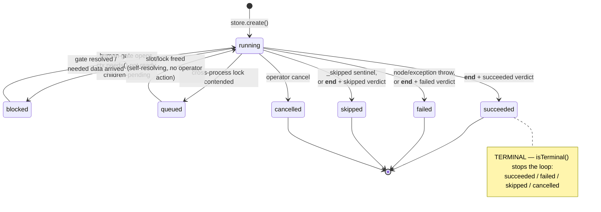

# pipeclaw — engine internals (run lifetime)

Split out of `README.md` to keep that file focused on pipeline authoring.
Read this when debugging executor behaviour, working on `engine/executor.js`
itself, or wanting the full state-machine picture rather than the
high-level summary in the main README's *Run lifetime* section.

Full lifecycle of a single pipeline run, from creation through every
terminal path.

## Index

- [Store model](#store-model)
- [Creation](#creation)
- [Executor loop](#executor-loop)
- [Node dispatch](#node-dispatch)
- [Node outcomes → persistence](#node-outcomes--persistence)
- [Terminal (`__end__` reached)](#terminal-__end__-reached)
- [Resume from blocked](#resume-from-blocked)
- [Operator cancel](#operator-cancel)
- [Status transitions](#status-transitions)
- [Subflow data flow](#subflow-data-flow)

## Store model

`state-store` wraps `run-store`; all reads and CAS writes go to
`runtime.sqlite` only. `registry.sqlite` (platform) is never written by
pipeclaw — it is fully retired.

- **`runStore.X()`** → `runtime.sqlite` `flow_runs` (sole read/write store — dashboard, revival, gate-resolver)
- **`nodeExecutionsStore.X()`** → `runtime.sqlite` `flow_node_invocations` / `flow_node_executions` (one row per logical node dispatch / per attempt — also the identity source for a subflow node's real children, see *Subflow data flow* below)
- **`branchService.X()`** → `runtime.sqlite` `flow_branches` (legacy branch truth — read-only historical data; every subflow node's items are real `flow_runs` children now, see *Subflow data flow* below)

**`state_json` is entry-only, `result_json` is the accumulator**
("Option B"/B4, shipped 2026-08-18). `flow_runs.state_json` no longer
grows a key per dispatched node — persist calls filter it
(`engine/executor-persist.js`'s `toPersistableState`) down to just
entry/bookkeeping fields: `pipelineId` + `needs-resolver.js`'s
`ENTRY_FIELDS` (`runId`, `startedAt`, `args`,
`triggeredBy`, `cost`, `_display`, `approvedIds`/`rejectedIds`/
`editedTexts`/`approvalPending`/`approvalResults`, `_cascadeError`) + a
spawned child's `item`/`itemIndex`/`parentItem`.

A node's own output lives exclusively in
`flow_node_invocations.result_json` (written via
`nodeExecutionsStore.writeResult(invocationId, stateUpdate)`, **awaited**
— the very next dispatch-loop iteration depends on it having landed) and
is reconstructed on read by `assembleState(flowId, {runStore,
nodeExecutionsStore, baseState})`, which replays every completed
invocation's `result_json` onto `baseState` (latest `visit_seq` per node
wins) and also attaches `_subflowGroups` — this is what *Node dispatch*'s
`enrichedState` below actually is now, not the old `enrichWithSubflows()`.

## Creation

```js
store.create({ pipelineId, goal, initialState })
// → runStore.insert() → runtime: { status: 'running', revision: 0, lastStep: '__start__' }
```

## Executor loop

Iterates until terminal or not running:

1. `flow = store.get(flowId)` — reads `runtime.sqlite` via `runStore.get()`. If `isTerminal(flow.status)`, stop.
2. `nextNodeId = resolveEdge(edges, lastStep, state)` — inside a `cascade`-kind flow, a 2-arg edge `(state, error)` also receives the `NodeFailure` `{message, errorType}` the last dispatch threw (or `null` on success). See README.md's *Optional: `kind: cascade`* section and `engine/executor-errors.js`'s `NodeFailure`.
3. If `nextNodeId === '__end__'` → see *Terminal* below.
4. Otherwise: `store.markExecuting(nodeId)` (best-effort informational mark), then `result = await executeNode({ node, nodeId, state, flowId })`.

## Node dispatch

**`kind: 'code'`**
```js
enrichedState = assembleState(flowId, { runStore, nodeExecutionsStore, baseState: state })
update = await node.run(enrichedState, ctx)
```
`assembleState` replays this flow's own completed `result_json` rows onto `state` (which is entry-only — see *Store model* above), then attaches `_subflowGroups`: dual-mode per group, real `flow_runs` children if any exist, else legacy `flow_branches` → `{ _subflowGroups: { [group]: { [key]: row } } }`. `_subflowGroups` is **transient** — never written to `state_json`.

**`kind: 'agent'`**
```js
maybeBudgetGate() // skip or pause?
enrichedState = assembleState(flowId, { runStore, nodeExecutionsStore, baseState: state })
message = node.promptBuilder(enrichedState)
update = await dispatchSingleWithRetry(node, sessionKey, message)
```

**`kind: "subflow"`**
```js
enrichedState = assembleState(flowId, { runStore, nodeExecutionsStore, baseState: state })
items = node.selector(enrichedState)
```
Per item → `resolveOrCreateChild()` (`spawn-child.js`, race-safe find-or-create):
- Creates a **real** `flow_runs` row: `pipelineId = "<parentPipelineId>::<nodeId>"`, `state = { item, itemIndex, parentItem }` (nothing else — see `SUBFLOW_NODES.md`), `parentInvocationId` set.
- `runFlow(childFlowId)` fired fire-and-forget (`setImmediate`) — the child is driven by this SAME executor loop, recursively, as its own top-level flow.

If all siblings are already terminal (0 items, or a re-entry after they finished) → the parent advances past the subflow node immediately. Otherwise → parent blocked, `waitJson: { kind: "children-pending", childFlowIds }`. Once the last sibling child goes terminal, `child-resume-trigger.js` resumes the parent automatically (no polling) *if* `node.mode` is satisfied (`"any"`: ≥1 succeeded; `"all"`: every child succeeded) — otherwise it fails the parent directly and records a real `failure_events` row against the parent's own `flow_id` (`failure_kind: "subflow-mode-not-satisfied"` — not a throw, a policy decision once every sibling is terminal). See `SUBFLOW_NODES.md` for the full authoring guide.

**`kind: 'human-gate'`**
```js
enrichedState = assembleState(flowId, { runStore, nodeExecutionsStore, baseState: state })
pending = node.pendingSelector(enrichedState)
```
- If `pending` is empty → `gate_records.consumedAt` stamped, `stateUpdate: {}` → advance.
- Else → `gate_records` written (`nodeExecutionsStore.writeGateRecord`), `waitJson` built → blocked path (see *Node outcomes* below).

Gate delivery data (items, pending, timeoutMs, openedAt/consumedAt) lives **only** in the dedicated `gate_records` table now, never in `state_json` — a prior `"state.gates[nodeId]"` full-snapshot write was removed 2026-08-18 once `gate_records` fully superseded it as every real reader's source (`routes/runs.js`'s `.gates` response field, the internal `existingGate`/`openedAt` checks above). Decision bookkeeping (`approvedIds`/`rejectedIds`/`editedTexts`/`approvalPending`/`approvalResults`) is separate — written by `gates/gate-resolver.js` directly, and **does** survive in `state_json` (all five are in `ENTRY_FIELDS`).

## Node outcomes → persistence

**`stateUpdate` (normal advance)**
```js
freshAfterNode = store.get(flowId)   // re-read, guards a concurrent writer
nodeExecutions.write(...)            // execution-tracking row
await nodeExecutions.writeResult(invocationId, stateUpdate)
// → flow_node_invocations.result_json / result_written_at
persistRunningRetrying({ state: freshAfterNode.stateJson, lastStep: nodeId })
// → store.setRunning() (state filtered to entry/bookkeeping fields only)
// → runStore.casSetRunning() → runtime: running, revision++
```
`writeResult` is **awaited**, not fire-and-forget: the very next dispatch-loop iteration's `assembleState()` call depends on this having landed, or an edge function reading this node's own just-completed output would see it as still-missing — found live as an infinite busy-loop before this was fixed (2026-08-18).

There is no wide merge of `stateUpdate` into the persisted state anymore (removed 2026-08-18): `freshAfterNode.stateJson` is already entry-only, and any node-output fields a merge would have added get stripped right back out by the persist filter regardless — `stateUpdate`'s only real destination is `result_json`, above.

**`blockedInfo`** (code threw a `_kind`-stamped `NodeBlocked`, or an `_error` sentinel — a `NodeBlocked` with **no** `_kind` is not a wait at all, it's treated as a failure instead; see README.md's `ctx.blocked` entry under *Code-node `ctx` argument*)
```js
persistWaitingRetrying({ waitJson, statusReason })
// → store.setWaiting()
// → runStore.casSetWaiting() → runtime: status="blocked" (despite the
//   method's own name — there is no "waiting" status value in this
//   schema, see Status transitions below), revision++
```
Flow stops here; resumes via `POST /pipeclaw/resume-from-gate`.

**`skippedInfo`** (`_skipped` sentinel returned)
```js
persistSkipRetrying({ state, reason })
// → store.skip() → runStore.casSkip() → runtime: skipped, revision++
```
Flow ends.

**`exception`** (unhandled throw)
```js
persistFailRetrying({ message, failureNode })
// → store.fail() → runStore.casFail() → runtime: failed, revision++
```
Flow ends.

## Terminal (`__end__` reached)

```js
enrichedState = assembleState(flowId, { runStore, nodeExecutionsStore, baseState: state })
```
This is the 6th root read site, migrated 2026-08-18 (was `enrichWithSubflows`, raw-state-only, no `result_json` replay — `display()`/`successCriteria()` lost visibility into any node's own output the moment `state_json` stopped carrying it; found live via 2 failing tests).

```js
runAuditIfConfigured({ state: enrichedState })

finalState = pipeline.display
  ? { ...enrichedState, _display: display(enrichedState) }
  : enrichedState

verdict = pipeline.runAudit?.successCriteria({ ...enrichedState, ...finalState })
```
`finalState` sees `_subflowGroups`, `_display`, and every node's own `resultJson`-replayed output, all via `enrichedState`/`finalState` — it's safe to carry `_subflowGroups` through here too now (previously avoided on purpose): the persist filter (`toPersistableState`) strips it regardless of what `finalState` contains.

- **`'succeeded'`** (or no `successCriteria` defined) → `persistFinishRetrying({ state: finalState })` → `store.finish()` (filtered to entry/bookkeeping fields only) → `runStore.casFinish()` → runtime: succeeded, revision++
- **`'failed'`** → `persistFailRetrying({ state: finalState, failureNode: '__end__', message: finalState._successCriteriaReason ?? "successCriteria: failed" })` → `store.fail()` (filtered) → `runStore.casFail()` → runtime: failed, revision++
- **`'skipped'`** → `persistSkipRetrying({ state: finalState })` → `store.skip()` (filtered) → `runStore.casSkip()` → runtime: skipped, revision++

## Resume from blocked

`POST /pipeclaw/resume-from-gate { flowId, nodeId, decision }`

Route handler:
1. Reads flow from `runtime.sqlite` via `store.get()`.
2. `store.setRunning({ expectedRevision: flow.revision, lastStep, stateJson })` → `runStore.casSetRunning()` → runtime: running, revision++.
3. `setImmediate → executor.resume(flowId)` → `resolveEdge(edges, lastStep, state)` (edge decides next node, not re-entering the gate — same 2-arg `NodeFailure`-error mode as the executor loop above applies here too).

## Operator cancel

Any non-terminal state:

```js
state-store.cancel({ flowId, stateJson })
// → runStore.stampStateJson() (snapshot stateJson first)
// → runStore.cancelFlow() → runtime: cancelled, ended_at=now
//   (terminal guard: no-op if already terminal, returns cancelled:false)
```

## Status transitions

Real status values only — verified directly against `state/run-store.js`'s
own literal `status:` writes, not assumed from method names (`setWaiting`
the method actually writes status `blocked`; there is no `waiting` status
at all, despite the method's own name).

A flow is created already `running` — there is no "queued at creation,
poller picks it up" step (that described a poller-driven architecture
that was never built). `queued` **is** a real, currently-used status,
though — `run-store.js`'s `casSetQueued()` writes `status="queued"`, used
for waits on an *internal* resource that frees itself (the cross-process
lock — `executor.js`'s `withCrossProcessLockMaybe`), kept distinct from
`blocked` (which needs an operator/external actor) specifically so a
consumer can tell the two apart without inspecting `wait_json.kind`. A
prior version of this doc claimed no code path ever writes
`status="queued"` — that was already wrong by the time it was written,
not something this session's own changes broke.



## Subflow data flow

Subflow nodes never touch the parent's `stateJson`. Every subflow node's
items are real `flow_runs` children now — one child per item, its own
`flowId`, driven start-to-finish by this same executor. There is no
in-process branch-worker pool and no per-item write call from pipeline
code; a sub-node just returns a normal `stateUpdate` and the executor
persists the child's own row, exactly like any top-level flow.

**Write path** (implicit — nothing a pipeline author calls directly):

```
engine/executor-subflow-children.js: dispatchSubflowChildren()
  → engine/spawn-child.js: resolveOrCreateChild()
      → nodeExecutionsStore.findOrCreateInvocation({flowId, nodeId, subflowKey})
          → flow_node_invocations (runtime.sqlite):
              UNIQUE (flow_id, node_id, COALESCE(subflow_key,''), visit_seq)
              subflow_key = the item's key (see itemKey in SUBFLOW_NODES.md);
              visit_seq distinguishes a genuine loop-back re-entry from a
              retry/revival continuation of the same dispatch
      → store.create({ pipelineId: "<parent>::<nodeId>", parentInvocationId, ... })
          → flow_runs (runtime.sqlite): a REAL child row, its own flowId,
            status/current_step/state_json exactly like any flow
```
Every subsequent execution attempt of that same child (retries, revival) reuses the same invocation and just adds another `flow_node_executions` row — the invocation is created once per genuinely fresh pass through the subflow node.

**Read path** (transient, per execution step):

```js
assembleState(flowId, { runStore, nodeExecutionsStore, baseState: state })
```
→ `state/subflow-state.js`'s `getAllSubflowGroups()` — dual-mode per group: real `flow_runs` children exist for this groupId → use them (`flow_node_invocations.flow_id = parent`, `JOIN flow_runs ON parent_invocation_id`) — else fall back to the legacy `flow_branches` read (`branchService.listByFlow`), for flows that predate this migration. A group is never a blend of both.

→ `state._subflowGroups = { [groupId]: { [subflowKey]: row } }`, where:
- `row.data` — the child's own `resultJson` replayed onto its (entry-only) `stateJson` (`engine/result-replay.js`'s `replayResults` — every sub-node's returned update, keyed by sub-node id, e.g. `row.data.SCORE_LLM`). Was "the child's own full `stateJson`" directly until 2026-08-18 — safe while `state_json` still accumulated every node's own output; broke silently (a parent reading a prior child's output saw nothing) the moment the write cutover made `state_json` entry-only, fixed via this replay.
- `row.status`, `row.failedAt`/`doneAt`/`cancelledAt`, `row.awaiting` — folded from the child's real status/waitJson to match the shape code written against the old model already expects.
- `row.childFlowId` — the real flowId, for callers that want to navigate to it directly (e.g. a dashboard link).
- `_subflowGroups` is transient — computed fresh every step, never written back to `state_json`.

**Pending / subflow-item-level gate resolution:** a childFlows child's own human-gate sub-node blocks the child directly (`status='blocked'`, `waitJson={kind:'human-gate', items:[...]}`) — there is no separate "pending subflow items" query. `gates/gate-resolver.js` resolves it like any other flow's gate, keyed by the child's own `flowId` + `itemId`.
