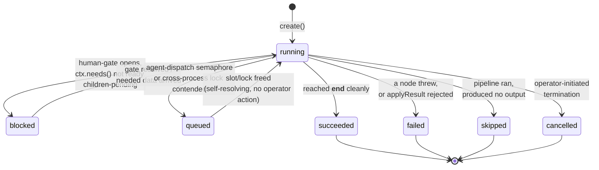

# pipeclaw

LangGraph-style pipeline runtime for openclaw. Plugin id: `pipeclaw`.
Live installs land at `~/.openclaw/extensions/pipeclaw/`; the source lives
in the private repo `igorjpimenta/oc-pipeclaw`. This README is written
for LLM agents doing engineering work in this plugin or building new
pipelines that target it.

**Source and install.** Install/update a release with
`openclaw plugins install git:igorjpimenta/oc-pipeclaw@<version> --force --dangerously-force-unsafe-install`
(see `RELEASING.md` for the release process).
Development clone: `~/.dev/job/igorpimenta/oc-pipeclaw`. Story worktrees are
created at `<clone>/.doppler/worktrees/<story>`, and each story ships as its
own PR (base `feat/plugin`).

## Public API

Consumers (oc-config, and later stories) install this repo as the
`@igorjpimenta/oc-pipeclaw` git dependency and import **only** through these
subpaths. Deep file paths are not a contract — only this table is.

| Subpath | Exports | Consumed by |
| --- | --- | --- |
| `@igorjpimenta/oc-pipeclaw` | plugin entry (default) | openclaw runtime |
| `…/errors` | `NodeFailure`, `NodeBlocked`, `GatewayHandoffNeeded`, error classifiers | oc-config |
| `…/lock` | `withLock`, `lockNameForFile`, `acquireLock`, `readLock` | oc-config |
| `…/browser-tabs` | `browserProfileForLock`, `beginTabSession`, `endTabSession` | browser-lease extension |
| `…/elevation` | `invokeElevated` | oc-config |
| `…/digest` | `sendDigestPush`, `configureApi` | oc-config |
| `…/tool-handoff` | run/tool handoff helpers (`notifyToolFired`, `registerDispatch`, …) | oc-config |
| `…/profile-lock` | `registerProfileWriteLock`, `profileEditResultPathFor` | oc-config |
| `…/ios-auth` | `authorizeBridgeRequest`, `sendUnauthorized` | oc-config |
| `…/state/db` | `openDb`, `getSharedDb`, `withSharedWrite`, `isSqliteBusy` | sibling extension (shared `runtime.sqlite`) |
| `…/state/batch-writer` | `enqueue`, `enqueueRaw`, `flush`, `flushAll` | sibling extension |
| `…/state/schema` | drizzle tables (`flowRuns`, `flowNodeExecutions`, …) | sibling extension |
| `…/state/migrator` | `createMigrator` | sibling extension |

The map is pinned by `test/unit/api/public-exports.test.js`; adding or
removing an entry is a breaking change for the consumers above.

Two companion docs hold deep-dive material split out of this file to keep
it focused on orientation and quick reference:

- **`ENGINE_INTERNALS.md`** — full executor state-machine detail (store
  model, every persistence call, status-transition map, subflow data flow).
  Read when debugging executor behaviour or touching `engine/executor.js`.
- **`SUBFLOW_NODES.md`** — full `kind:"subflow"` authoring guide (shape,
  sub-node calling convention, deriving `subflowKey`, locks, retrying one
  item, nesting). Read before writing or modifying a subflow node.

## Index

- [Quick orientation](#quick-orientation)
- [Glossary](#glossary)
- [Run lifetime](#run-lifetime)
- [Pipeline schema (canonical)](#pipeline-schema-canonical)
- [Common author mistakes](#common-author-mistakes-read-this-before-writing-a-pipeline)
- [Node kinds](#node-kinds)
- [Subflow nodes (childFlows)](#subflow-nodes-childflows)
- [Node authoring reference](#node-authoring-reference)
- [Groups (compound parents in the dashboard)](#groups-compound-parents-in-the-dashboard)
- [Conventions](#conventions-and-what-breaks-if-you-violate-them)
- [Session keys (subagents spawned by pipeclaw)](#session-keys-subagents-spawned-by-pipeclaw)
- [State conventions](#state-conventions)
- [Status transitions](#status-transitions)
- [CLI](#cli)
- [Tool surface (agent-facing)](#tool-surface-agent-facing)
- [Dashboard](#dashboard)
- [Declared views (embed-view pattern)](#declared-views-embed-view-pattern)
- [Common tasks](#common-tasks)
- [If you see…](#if-you-see)
- [Operational quirks](#operational-quirks)
- [Plugin config (default values)](#plugin-config-default-values)
- [SQLite shape (for direct queries / surgery)](#sqlite-shape-for-direct-queries--surgery)

## Quick orientation

> **One-line model:** A `Pipeline` is `{ nodes, edges, state }` loaded
> from a JS module. A `Flow` is one persistent run of a pipeline. The
> `Executor` walks nodes by id, applies their `stateUpdate`, picks the
> next id from `edges[currentId](state)`, persists every revision to
> sqlite, and exits the loop on terminal/blocked status.

| You need…                               | Look at                                        |
| --------------------------------------- | ---------------------------------------------- |
| Plugin entry (wires everything)         | `index.js`                                     |
| Run loop / node dispatch                | `executor.js: runFlow`, `runStep`              |
| Pipeline file discovery + validation    | `loader.js`                                    |
| sqlite persistence (`flow_runs` table)  | `state-store.js`                               |
| CLI command implementations             | `cli.js`                                       |
| Agent-facing tools                      | `tool.js`                                      |
| Approval helpers (CLI + dashboard)      | `gates.js`                                     |
| Dashboard server                        | `dashboard/server.js`                          |
| Dashboard frontend                      | `dashboard/src/`                               |
| Plugin manifest (tools + config schema) | `openclaw.plugin.json`                         |

## Glossary

| Term            | Meaning                                                                              |
| --------------- | ------------------------------------------------------------------------------------ |
| **pipeline**    | Static definition: `{ id, goal, state, nodes, edges, groups? }` exported by a module. |
| **node**        | One unit of work. Identified by its key in `pipeline.nodes`. Has a `kind`.            |
| **edge**        | `(state) => nextNodeId`. Lives in `pipeline.edges[fromNodeId]`. Pure function.       |
| **flow**        | One persistent run of a pipeline. Identified by `flowId` (UUID).                     |
| **state**       | Mutable JSON for a single flow. Persisted with every revision.                       |
| **revision**    | Monotonic counter. Increments every time a node returns a `stateUpdate`.             |
| **wait**        | `flow.waitJson` is set; flow is `blocked` or `waiting`. Resumed by external action.   |
| **session**     | One subagent JSONL conversation. Owned by an agent. See *Session keys* below.        |
| **item key**    | Slug identifying one item inside a `subflow` fan-out.                               |

## Run lifetime

> Full state-machine detail (store model, every persistence call, the
> status-transition diagram, and the subflow read/write data-flow) moved to
> **`ENGINE_INTERNALS.md`** — read that when debugging executor behaviour
> or touching `engine/executor.js` itself. Summary below is enough for
> ordinary pipeline authoring.

A flow is created `running` at `__start__` (`store.create`). The executor
loop repeatedly resolves `edges[lastStep](state)` to the next node id,
dispatches it per its `kind` (`code` runs `node.run`; `agent` builds a
prompt and dispatches a subagent; `subflow` fans `.selector(state)` out
into real child `flow_runs`, one per item, and blocks until every sibling
is terminal; `human-gate` builds `waitJson` and blocks), and persists the
outcome — a `stateUpdate` advances and loops again, a thrown error or
`_error` sentinel fails/blocks the flow, `__end__` runs `runAudit` and
writes the terminal status (`succeeded`/`failed`/`skipped`). Blocked flows
resume via `POST /pipeclaw/resume-from-gate`; any non-terminal flow can be
cancelled by an operator. See `ENGINE_INTERNALS.md` for the exact
persistence call at each step and the full status-transition map.

## Pipeline schema (canonical)

```js
// ~/.openclaw/workspace/.pipelines/<pipelineId>/index.js
export default {
  id: "my-pipeline",                          // string, file-system safe
  goal: "one-line description",               // shown in the dashboard
  state: { /* initial state shape */ },       // merged with args at start
  nodes: {
    NODE_A: { kind: "code", run: (state) => ({ /* stateUpdate */ }) },
    NODE_B: {
      kind: "agent",
      agent: "scout",
      promptBuilder: (state) => "…",          // string returned to the agent
      applyResult: (state, output) => ({ /* stateUpdate */ }),
    },
  },
  edges: {
    __start__: () => "NODE_A",                // first hop, always required
    NODE_A:    (s) => s.cond ? "NODE_B" : "__end__",
    NODE_B:    () => "__end__",
  },
  // Optional. Logical groupings the dashboard renders as compound parents.
  groups: {
    SCAN: { label: "scan", kind: "pair",
            members: ["SCAN_CODE", "SCAN_AGENT"] },
  },
  // Optional. Pipeline-declared dashboard surfaces (see "Declared views" below).
  views: [
    { id: "outcomes", kind: "funnel", label: "outcomes (last 30d)",
      source: { kind: "frontmatter-dir", path: SENT_DIR, timeField: "sent-at" },
      stages: [
        { id: "sent",    label: "sent" },
        { id: "replied", label: "replied", outcomeIn: ["replied", "won"] },
        { id: "won",     label: "won",     outcomeEq: "won" },
      ] },
  ],
};
```

**Required exports:** `id`, `state`, `nodes`, `edges`. Validation rules
in `loader.js:80-130`.

**Reserved node ids:** `__start__`, `__end__`. Never appear in `nodes`;
must appear in `edges` (at least `__start__`).

### Optional: `kind: "cascade"` — retry-on-failure as a flow characteristic

A flow-level (not node-level) `kind`, orthogonal to node `kind`. Declared
either directly on a top-level pipeline (`export default { id, kind:
"cascade", ... }`) or on a `subflow` node's `.flow.kind` — the loader
copies it onto the synthesized child pipeline exactly like it copies
`nodes`/`edges`, so a single step of a bigger pipeline can be isolated
into its own cascade-kind subflow.

The mechanic (`executor.js`'s catch block): in a cascade-kind flow, ANY
throw is treated like a completed dispatch, not a failure. `lastStep`
advances to the node that just threw (the failure itself is still
durably recorded via the normal execution-write path), and the loop
`continue`s — so on the very next pass it's **that node's own edge
function** that decides what happens next, exactly the way it would
after a success (typically by checking presence/absence of its own
output in `state`). There is no separate "retry from start" reset and no
engine-level "terminal" check: an edge function that has exhausted every
option it wants to try simply returns no next node, which the
pre-existing `!nextNodeId` → `persistFailRetrying` path already handles
— giving up is just an ordinary edge decision, not a special case.

```js
// A minimal cascade: CODE_LOGIN throws once, its own edge escalates to
// AGENT_LOGIN; if AGENT_LOGIN also throws, its edge gives up (returns
// no next node) and the flow fails normally.
export default {
  id: "ensure-login",
  kind: "cascade",
  state: {},
  nodes: { CODE_LOGIN, AGENT_LOGIN },
  edges: {
    __start__: (state) => (state.AGENT_LOGIN ? "__end__" : "CODE_LOGIN"),
    CODE_LOGIN: (state) => (state.CODE_LOGIN ? "__end__" : "AGENT_LOGIN"),
    AGENT_LOGIN: (state) => (state.AGENT_LOGIN ? "__end__" : null),  // give up
  },
};
```

Author-side responsibilities: exhaustion (when to stop trying and let
the flow fail) and any retry-count cap are entirely up to the edge
functions — nothing bespoke is needed since `state/node-executions.js`'s
`queryErrorsByFlow`/`queryByNode` already let an edge consult prior
attempts on this flow if it needs more than presence/absence in `state`.

**`NodeFailure` and 2-arg edge functions** (`engine/executor-errors.js`,
`engine/executor-helpers.js`'s `resolveEdge` — "Eradicate soft errors"):
a cascade node's own `run()`/`apply()`
throws `NodeFailure(message, { errorType })` instead of soft-returning
`{ok: false, error_type}` on failure — `errorType` reuses the existing
vocabulary (`never_attempted | confirmed_absent | inconclusive |
infra_unavailable | blocked`, or `null` for classification-less failures).
Any plain `Error` works too; `errorType` is just `null` in that case.

An edge function may opt into receiving that thrown error as a **second
parameter** — `resolveEdge` dispatches on `fn.length`: a 2-arg edge
`(state, error) => next` gets `{message, errorType}` (or `null` on a
successful dispatch); a 1-arg edge `(state) => next` is unaffected, the
default and still the overwhelming majority of edges in this codebase.
This is purely additive — no existing edge needed to change.

```js
// CODE's own edge routes on the REAL thrown error, not a soft field —
// give up immediately on a genuine confirmed-absent/inconclusive outcome,
// fall through to an agent-fallback leg for anything else.
edges: {
  CODE: (state, error) => {
    if (state.CODE?.ok) return "__end__";
    if (error?.errorType === "inconclusive") return null;
    if (error?.errorType === "infra_unavailable") return "ENSURE_INFRA";
    return "AGENT_FALLBACK";
  },
},
```

**Caveat — a real footgun**: a default value (`(state, error = null) => ...`)
or a rest param collapses `fn.length` back down, silently falling to
1-arg (legacy) mode with no error at all. Declare the parameter plainly.

**Attempt counting across dispatches**: there is no supported built-in way
to do this today. `_stepHistory` (the old mechanism this section used to
point to) was removed from the engine entirely — it's not a real
`state_json` field anymore, and nothing replaced it for pipeline-author
use (`ctx` exposes no execution-count accessor, and `assembleState()`
never adds one to `state`). A `NodeFailure` throw also never merges
`state[nodeId]`, so a self-tracked counter on the throwing node's own
output can't survive a failing attempt either — the same "no room for an
arbitrary counter" problem this section already calls out.
`freelance_workana-proposal`/`-reply`/`-touch-cadence`'s
`SUBMIT_CODE`/`SEND_REPLY_CODE`/`SEND_NUDGE_CODE` cascades used to carry
an infra-unavailable auto-recovery loop (`↔ ENSURE_INFRA_CODE`) that
shipped **intentionally uncapped** rather than solve this — a
`_stepHistory`-backed cap was removed on 2026-08-12 because it silently
carried an exhausted count across operator-triggered manual retries
(retry only clears the failed node's own result, never a lifetime
counter). The uncapped replacement then genuinely looped forever
whenever the browser/CDP stayed down (real incident, 2026-08-19 — see
`freelance_workana-proposal/nodes/propose/submit/index.js`'s header), so
the loop was removed outright rather than re-capped: `infra_unavailable`
now ends each of these three cascades directly, same as any other
failure class, and the operator retries manually via the flow's own
Retry action once infra is actually healthy. If a future pipeline
genuinely needs a bounded automatic retry count, the only sound pattern
is a sibling `code` node in the same cascade that never throws and
always merges into `state` on every pass — have *that* node's own
`run()` increment its own attempts field, and have the throwing node's
edge read that (capped) instead of trying to count its own dispatches or
looping unconditionally.

**Generalized engine-wide (2026-08-24)**: the same rationale that removed
the SUBMIT infra loop applied to every `kind:"agent"` node's `node.retry`
config — `dispatchAgentWithRetry` (`engine/executor-subagent.js`) no
longer retries at all, for any agent dispatch, anywhere. Live cost data
was the trigger: `freelance_workana-proposal::SCORE` burned up to 41
calls per flow retrying against a single unreliable model with no
fallback, and 11 of 13 flows failed anyway — the retries weren't
rescuing the outcome, just multiplying cost on calls that failed
regardless. Every agent node is now a single attempt; a failure throws
immediately, records as a normal failure event, and the operator retries
manually — no exceptions, no per-node opt-out. Any `retry: {...}` left on
a node definition is inert and ignored.

**Presence-check pattern for a single-outcome leg**: when a leg either
throws or returns real payload data with no need to classify *why* it
failed (an agent-fallback entry whose own `apply()` throws rather than
soft-returning an error field, say), its edge collapses to a presence
check: `(state) => (state.AGENT_ID !== undefined ? "__end__" : null)` — a
throw never merges `state[nodeId]`, so presence alone (any shape) is the
success signal.

### Optional: `recoveryActions`

Pipelines can declare custom operator-recovery actions surfaced on the
iOS Failures inbox. Each entry is a `kind` (URL slug + iOS dispatch
key) → descriptor + handler. The framework merges these with three
always-on defaults (`retry`, `ignore`, `unignore`) and exposes the
result per failure row as `available_actions[]`; iOS renders verbatim,
no pipeline-id awareness.

```js
recoveryActions: {
  skip: {
    label: "Skip",
    icon: "tray.and.arrow.down.fill",   // SF Symbol — iOS uses verbatim
    tint: "danger",                     // info | warning | danger | neutral
    destructive: true,                  // optional; UI may confirm before firing
    requiresBranch: true,               // optional; hides on flow-level failures
    appliesTo: ["skip-only", "redraft", "investigate"],  // recovery_hint filter
    handler: async ({ failure, body, api, logger }) => {
      // failure : the failure_events row (see SQLite shape below)
      // body    : parsed JSON POST body (e.g. { via?, reason? })
      // returns : { ok: true, ...arbitrary } or throws
    },
  },
},
```

**Kinds reserved for the framework:** `retry`, `ignore`, `unignore`.
Pipelines that declare these are silently dropped from the merge — use
custom kinds (`skip`, `archive`, `mark-spam`, whatever your pipeline's
semantic is).

**Auto-resolve:** after a custom handler succeeds, the framework
resolves any open failure rows for the same `(pipeline_id,
branch_item_id)` tuple with `resolved_via = "auto:operator-<kind>"` —
pipelines don't have to touch the failure store themselves.

Live example: `freelance_workana-proposal/index.js`'s `skip` handler
writes `workspace/.shared/freelance/workana/skipped/<jobId>.md` so
future FILTER passes exclude the listing. Implementation lives in
`recovery-actions.js` (descriptor merge + handler lookup); HTTP
dispatch in `index.js: /pipeclaw/failures/<id>/action/<kind>`.

## Common author mistakes (read this before writing a pipeline)

If you've written pipelines for other graph runtimes (LangGraph, n8n, Airflow, etc.), some of pipeclaw's names and call conventions will not be what you expect. The loader catches the structural mistakes; the runtime catches the rest. Skim this table first — every row below has been hit by a real author shipping a real pipeline.

| Wrong | Right | What breaks |
|---|---|---|
| `initialState: () => ({...})` | `state: { ...staticShape }` | Loader error: `missing .state`. Runtime fills `runId`, `startedAt`, etc. itself — your static shape is merged with run args at flow start. |
| `subflow: { subgraph: { nodes, edges } }` | `subflow: { flow: { nodes, edges } }` | Loader error: `node X (subflow) missing .flow`. |
| `description: "..."` (top-level) | `goal: "..."` | Silently ignored — dashboard renders `goal`. Cosmetic only, but the pipeline list looks empty. |
| `buildBrief: ({ state, item }) => "string"` | `promptBuilder: (state) => "string"` | Runtime calls `node.promptBuilder(state)` positionally, always single-arg — your function gets `state` not `{state, item}`. Subagent receives garbage. Inside a `subflow` sub-node, the item is `state.item`, not a second argument. |
| `apply: ({ state, output }) => ({...})` (object destructure) | `apply: (state, output) => ({...})` | Same as above — runtime calls positionally, always `(state, output)`, whether the node is top-level or a `subflow` sub-node (`applyResult` also accepted for `agent` kind). There is no `subCtx` and no 3-arg form — a `subflow` sub-node is dispatched exactly like a top-level node; the item lives at `state.item`. |
| Gate node with `apply: …`, `buildPayload: …`, `delivery: …`, `buttons: […]` | Gate node with `approvalRequestBuilder: (state, itemId) => ({title, description})` only | Gate's apply path is owned by `gate-resolver.js` (the oc-pipeclaw-ios bridge wires the callback). A decision lands in `state.approvedIds`/`state.rejectedIds` (or `state.approvalPending[itemId]` mid-flight) — read it in your edge function, e.g. `edges.GATE: (state) => state.approvedIds?.includes(state.item?.id) ? "STAMP" : "STAMP_REJECT"`. |
| Edge function reads `flow.data` or a `subCtx` argument inside a `subflow` sub-node | Edge function reads `state` directly — same as top-level | There is no `subCtx`. Inside a subflow sub-node: `edges.GATE: (state) => state.GATE?.decision === "approve" ? "STAMP" : "__end__"` (or read `state.approvedIds`, per the row above) — the subflow item is `state.item`. |
| Fallback pair declared via naming convention only | Add a `groups:` entry tying the pair | The dashboard won't render them as a compound parent. See *Groups (compound parents in the dashboard)* below. |
| Node id with hyphen (`send-cr`) | Node id with underscore/upper (`SEND_CR`) | See *Node IDs are token-style — no hyphens* below. |

### What the validator catches (loader.js)

These are hard-stops at pipeline load time — the gateway log shows `pipeclaw loader: <id>/ failed to load: <reason>`:

| Loader error | Fix |
|---|---|
| `pipeline must export an object` | `export default { ... }` — not a class, not a function. |
| `missing .id` | Add `id: "team_name"` at the top of the export. |
| `missing .state` | Use `state: { ...staticShape }`, not `initialState`. |
| `missing .nodes` | Provide `nodes: { ... }` even for one-node pipelines. |
| `missing .edges` | Provide `edges: { __start__: (s) => "FIRST_NODE", ... }`. |
| `edges must define __start__` | Always wire `__start__` to your first node. |
| `node "X" has unknown kind "Y"` | Use one of: `code`, `agent`, `subflow`, `human-gate`. |
| `node "X" (subflow) missing .flow` | Use `flow: { nodes, edges }`, NOT `subgraph:`. |
| `node "X" .flow.edges must define __start__` | Inner flow needs its own `__start__` edge — wire it to the first per-item sub-node. |

### What only the runtime catches

Past the loader, these only surface during a real flow:

- **`approvalRequestBuilder` returning a non-object** — runtime can't serialize it for delivery. Return `{ title, description }` at minimum.
- **`promptBuilder` returning a non-string** — subagent will see `[object Object]`. Stringify your inputs into a prompt.
- **`apply` returning a non-object** — runtime expects a `stateUpdate`, wrapped under your own node id, whether the node is top-level or a `subflow` sub-node (see *Subflow nodes (childFlows)*). Returning `null` or `undefined` is fine (no update). Returning a number / string throws.
- **`pendingSelector` for `gate`/`human-gate` returning items that don't match what the operator's decision keys against** — gate-resolver can't map decisions back to items. For a `subflow`'s own gate sub-node, this means returning something other than `state.item?.id` (a childFlows child is always exactly one item).
- **Forgetting `itemKey` on `subflow` when the item's natural key isn't `.id`/`.listingId`** — `deriveSubflowKey` falls through to `String(item)`, which is almost never what you want for an object. See *Deriving `subflowKey`* in `SUBFLOW_NODES.md`.
- **Cross-process lock with no installed `lock.js`** — `crossProcessLock: "browser:foo"` requires the helper at `~/.openclaw/extensions/pipeclaw/locks/lock.js`. Already present in stock installs.

### Two gotchas that *look* like bugs but aren't

These cost an authoring session each. Worth knowing.

#### Edge functions: dashboard parses the source, not the runtime value

The dashboard graph view (`dashboard/pipeline-graph.js`) extracts edge targets by **regex-matching literal node-id strings in the edge function source code**. It cannot follow closure variables, imported constants, or template-string interpolation. If you write:

```js
// Closure variable — invisible to dashboard
import { buildPrimeNodes } from "./lib/prime-nodes.js";
const nextNodeId = "ENSURE_LOGIN_CODE";
const edges = {
  PRIME_SCAN: (state) => state.done ? "PRIME_FILL" : nextNodeId, // ← dashboard sees PRIME_FILL only
};
```

…only the `"PRIME_FILL"` literal is detected — the closure variable disappears. The runtime still routes correctly, but the dashboard graph shows the edge as a dead end (or as `→ ?`).

**Fix:** keep both target ids as literal strings in the edge function body:

```js
const edges = {
  PRIME_SCAN: (state) => state.done ? "PRIME_FILL" : "ENSURE_LOGIN_CODE", // ← both visible
};
```

Factories that compute targets should return only nodes; let each pipeline define its own edges so the literals live in the pipeline source.

#### Pipeline reload only refreshes `index.js`, not its `file:///` imports

The pipelines-watcher reloads each pipeline's `index.js` via a `data:` URL (forces a fresh import per the comment in `loader.js`). But the pipeline's `import { ... } from "file:///.../lib/foo.js"` statements go through Node's normal ESM loader — and **Node caches modules by URL forever within a process**. Edits to shared `lib/` files used by pipelines won't take effect until you restart the gateway.

**Fix:** restart the gateway after editing any `lib/` file:

```sh
launchctl unload ~/Library/LaunchAgents/ai.openclaw.gateway.plist
launchctl load   ~/Library/LaunchAgents/ai.openclaw.gateway.plist
```

If you only edit a pipeline's own `index.js`, the watcher handles the reload — no restart needed.

### Recommended skeleton (copy this and modify)

```js
import path from "node:path";
import os from "node:os";

const ROOT = path.join(os.homedir(), ".openclaw");

export default {
  id: "myteam_my-flow",
  goal: "one-line description shown in the dashboard",
  // Identity surfaces wherever the pipeline shows up in operator UIs.
  //   emoji      — dashboard headers, push notifications, Live Activity widgets
  //   sfSymbol   — iOS Inbox pipeline-row icon (any valid SF Symbol name; see
  //                Apple's SF Symbols app). Falls back to "tray.fill" on the
  //                bridge when omitted, so this field is optional but recommended.
  //   displayName — human label used everywhere a pipeline is named.
  identity: { emoji: "🧩", sfSymbol: "puzzlepiece.fill", displayName: "My flow" },
  schedule: ["0 9 * * *"],            // optional cron(s), GMT-3 if your gateway is in BR

  // Static state shape. Merged with run args at flow start. Don't add an
  // `errors` array here — errors are never a stateJson field; every node
  // failure is recorded to flow_node_executions and served as the
  // top-level errorEntries[] (see State conventions below).
  state: {
    items: [],
    parallel: {},
  },

  nodes: {
    PRIME: {
      kind: "code",
      run: async (state) => ({ primedAt: Date.now() }),
    },
    SCAN: {
      kind: "agent",
      agent: "marketplace-scout",
      skill: "scan-some-source",
      promptBuilder: (state) => `Scan and return JSON. Context: ${state.runId}`,
      apply: (state, output) => ({ items: JSON.parse(output.text) }),
    },
    // subflow nodes fan out into real child flows — see "Subflow nodes
    // (childFlows)" below for the full authoring guide. Never set
    // .groupId; it's always the node's own id ("PROCESS" here).
    PROCESS: {
      kind: "subflow",
      itemKey: "id",
      selector: (state) => state.items ?? [],
      flow: {
        nodes: {
          WRITE: {
            kind: "agent",
            agent: "content-writer",
            promptBuilder: (state) => `Process item ${state.item?.id}.`,
            apply: (state, output) => ({ WRITE: { ...state.item, result: output.text } }),
          },
        },
        edges: {
          __start__: "WRITE",
          WRITE: "__end__",
        },
      },
    },
  },

  edges: {
    __start__: () => "PRIME",
    PRIME: "SCAN",
    SCAN: (state) => (state.items?.length ? "PROCESS" : "__end__"),
    PROCESS: "__end__",
  },

  // Optional. Tie code+agent pairs together for the dashboard.
  groups: {
    SCAN_GROUP: { label: "scan", kind: "pair", members: ["SCAN", "SCAN_AGENT"] },
  },

  // Optional. Run-summary writer.
  runAudit: {
    runsDir: path.join(ROOT, "workspace", ".pipelines", "myteam_my-flow", "runs"),
    summarize: (state) => ({
      runId: state.runId,
      items: state.items?.length ?? 0,
      processed: state.processed?.length ?? 0,
    }),
  },
};
```

## Node kinds

| `kind`              | Required fields                                                                      | Returns                | Exits to                                  |
| ------------------- | ------------------------------------------------------------------------------------ | ---------------------- | ----------------------------------------- |
| `code`              | `run(state, ctx) => stateUpdate \| Promise<stateUpdate>` — `ctx` exposes `invokePipeline` (see below) | `stateUpdate`          | normal edge                               |
| `agent`             | `agent`, `promptBuilder(state)`, `applyResult(state, output)`. Optional `circuitBreaker: true` — see *Circuit breaker* below. | `stateUpdate`          | normal edge                               |
| `subflow`           | `selector(state) => Item[]`, `flow: { nodes, edges }` (required — no other shape). Never set `.groupId` — it's always the node's own id; the loader throws if you set it. See *Subflow nodes (childFlows)* below for the full authoring guide. | one real child `flow_runs` per item; parent blocks (`waitJson.kind:"children-pending"`) until every sibling child is terminal, then auto-resumes **if `mode` is satisfied** — otherwise the parent is failed directly, with a real retryable `failure_events` row | normal edge, once all children terminal and `mode` satisfied |
| `human-gate`        | `pendingSelector(state) => Item[]`. Each item is `string` *or* `{ id: string, reason?, hint?, text?, editable? }` — see *Human-gate pending item shape* below | sets `waitJson`; flow → `blocked` | resumes via CLI `approve` / `respond` *or* dashboard GateForm |
| `gate`              | `pendingSelector` + `approvalRequestBuilder`. Channel-agnostic per-item gate. Delivery + callback handled by the app-side bridge (oc-pipeclaw-ios: iPhone Inbox + AgentApproval LA). Optional `discuss: { agent, promptBuilder }` opts the gate into an iOS chat surface — see *Per-gate discuss opt-in*. | sets `waitJson` (`pending: string[]`, `items: [{itemId, requestPayload}]`) | resumes via any channel's resolver call into `gate-resolver.recordItemDecision` |

A `code`-then-`agent` fallback (deterministic primary path, LLM-driven
recovery leg) is no longer a distinct node kind — author it as a
single-item `subflow` node (`selector: () => [{ id: "only" }]`) whose own
`flow.kind: "cascade"` child flow routes between an ordinary `code` entry
and an ordinary `agent` entry via hand-authored edges, with `mode: "all"`
so the engine fails the parent automatically if neither leg succeeds. See
*Optional: `kind: "cascade"`* above for the underlying mechanic and a
worked `CODE_LOGIN`/`AGENT_LOGIN` example.

Detailed dispatch logic: `executor.js` lines 380–730.

## Subflow nodes (childFlows)

> Full authoring guide (minimal shape, sub-node calling convention, deriving
> `subflowKey`, reading results downstream, locks/concurrency, retrying one
> item, nesting) moved to **`SUBFLOW_NODES.md`** — read that before writing
> or modifying any `kind:"subflow"` node.

A `subflow` node fans a `.selector(state)` array out into one real,
independent flow per item — each item's own `flow_runs` row, driven by the
exact same executor as any top-level flow. This is the ONLY subflow shape;
there is no simple/inline mode, and the loader rejects `.groupId` (it's
always the node's own id). Sub-nodes inside `flow.nodes`/`flow.edges` are
dispatched **identically** to root-level nodes — same `run`/`promptBuilder`/
`apply`/`pendingSelector` signatures, no `subCtx`, every return wrapped
under its own node-id key. Outside the subflow, read a child's results at
`state._subflowGroups[groupId][subflowKey]`.

## Node authoring reference

General node-authoring mechanics that apply to any node kind, at any
level (top-level or a subflow's sub-node) — none of this is
subflow-specific, even though earlier revisions of this doc nested it
under *Subflow nodes*.

### Circuit breaker (`node.circuitBreaker`)

An opt-in flag on any `kind:"agent"` node — top-level, or a cascade
sub-node inside a `flow.kind:"cascade"` subflow's own `flow.nodes` — that
fails fast instead of repeatedly dispatching an agent that's known to be
broken:

```js
FLAKY_AGENT: {
  kind: "agent",
  agent: "flaky-thing",
  circuitBreaker: true,               // opt-in; default false/absent = no-op
  promptBuilder: (state) => "…",
  applyResult: (state, output) => ({ FLAKY_AGENT: output }),
}
```

Implemented entirely inside `dispatchAgentEntry` (`engine/executor-nodes.js`)
— the single dispatch path every `kind:"agent"` node goes through,
regardless of whether it's a top-level node or a cascade sub-node running
inside its own child flow. Before doing any work — before the budget gate, before building the
prompt, before spawning a session — it checks
`nodeHealthStore.isBlocked(pipelineId, nodeId)` and throws immediately if
blocked, with a message that includes the exact reset command:

```
unhealthy agent dispatch: "<nodeId>" is blocked after a prior failure —
reset via "openclaw pipeclaw node-health reset <pipelineId> <nodeId>"
once the underlying issue is confirmed fixed
```

On a genuine dispatch failure it calls `nodeHealthStore.markUnhealthy(...)`
before re-throwing, which blocks every future dispatch of that
`(pipelineId, nodeId)` pair until an operator resets it — see *CLI*
below (`openclaw pipeclaw node-health status|reset`). Deliberately does
**not** mark unhealthy for `NodeBlocked` (an ordinary budget-gate pause,
not a dispatch failure) or `GatewayHandoffNeeded` (the subagent runtime
being unreachable in the current context, not evidence the agent itself
is broken).

Gated purely on the flag — a node that never sets `circuitBreaker` is a
complete no-op through this whole path, so plain agent nodes are
unaffected unless they opt in. Every cascade sub-node that used to get
automatic circuit-breaker protection under the old `kind:"fallback"`
mechanism now needs this flag set explicitly — see `ensure-login-node.js`
factories and `submit-agent.js` files under `workspace/.pipelines/` and
`workspace/.shared/` for worked examples.

### Gate `approvalRequestBuilder` — editable surfaces

`approvalRequestBuilder(ctx, item)` returns the payload the gate UI renders. Standard fields:

| Field | Surface |
|---|---|
| `title` | Card header on iOS Inbox |
| `description` | Card body — verbose; can include layout markers |
| `editableText` | Prose body the iOS edit-sheet pre-fills with AND the iOS preview card shows. The free-form content the operator commits if they hit Approve unchanged. Body-only — no structured metadata. (Legacy alias: `editableDraft` — bridge accepts both for one transition cycle.) |
| `editableFields` | Optional `[ { id, label, type, value, options?, prefix?, helper? } ]` — pipeline-declared structured fields rendered as tappable chips above the prose body. iOS picks input UI from `type`. |
| `references` | Array of `{ id, label, body }` chips on the iOS gate row + DiscussView |

**Prose body (`editableText`)**: pipelines with a free-form editable surface (workana-reply, touch-cadence, workana-proposal's prose) set this. The full-prose edit sheet renders + commits its content. If omitted (`undefined`), the executor auto-fills from the subflow's prior code-node outputs — the last `{ ..., text: "…" }` shape wins. Set `editableText: ""` explicitly to opt OUT.

**Structured fields (`editableFields`)**: pipelines that store metadata alongside the prose (workana-proposal's frontmatter: budget / timeframe / language) parse it once at builder time and expose each value as one entry. iOS renders a chip per entry; tap → focused single-field editor matching `type`; save → `apply-draft` `fields:` payload → server's `persistRevisedMeta` writes back. Pipelines without structured metadata omit the array.

Field-entry shape:

| Key | Required | Notes |
|---|---|---|
| `id` | yes | Frontmatter key on disk (or any persistence key the pipeline understands) |
| `label` | yes | Display label for the chip + sheet header |
| `type` | yes | `text` / `multiline` / `money` / `enum`. Unknown types degrade to `text` on client. |
| `value` | yes | Current value as a string. iOS renders display formatting per type (e.g. `money` gets thousand-separated). |
| `options` | for `enum` | Array of allowed string values. Renders as segmented control (≤4) or picker (>4). |
| `prefix` | optional | For `money`: rendered before the value on both chip + input (e.g. `"R$"`). |
| `helper` | optional | Footer hint shown in the single-field editor. No hardcoded copy on iOS — pipelines own the wording. |
| `editable` | optional, default `true` | When `false`, the chip renders read-only (no tap target, muted styling). Useful for display-only context fields the operator should see but not edit (e.g. `source-listing`, `drafted-at`). |

Example (workana-proposal):

```js
return {
  title: `Proposal for ${listing.id} (score ${listing.score})`,
  description: body,                         // long blob with markers
  editableText: prose,                       // body-only
  editableFields: [
    { id: "budget",    label: "Budget",    type: "money", prefix: "R$", value: fm.budget,
      helper: "Numeric BRL the bid form receives." },
    { id: "timeframe", label: "Timeframe", type: "text",  value: fm.timeframe,
      helper: "Delivery duration in the draft's language." },
    { id: "language",  label: "Language",  type: "enum",  value: fm.language,
      options: ["pt-BR", "en", "es"],
      helper: "Language code for the draft body." },
    // Read-only context — operator sees it, can't tap to edit.
    { id: "drafted-at", label: "Drafted", type: "text", value: fm["drafted-at"], editable: false },
  ],
  references,
};
```

### Lock modifier (any node)

One lock primitive:

| Field                       | Scope                | Acquired before  | Released after           |
| --------------------------- | --------------------- | ---------------- | ------------------------ |
| `crossProcessLock: "kind:id"` | Filesystem, cross-process | node body runs | node body returns/throws |

Filesystem-backed, so it serializes against everything that touches the same resource: sibling children of a `subflow` node, other top-level nodes in the same flow, other pipelines, and any standalone script that declares the same lock name — the lock file at `~/.openclaw/locks/<name>.lock` is honored across processes.

```js
SUBMIT_CODE: {
  kind: "code",
  crossProcessLock: "browser:freelance",   // cross-process filesystem mutex
  run: async (state, ctx) => { /* ... */ }
}
```

No script should self-lock internally (`withLock(...)` wrapping its own `main()`) — that only creates a deadlock risk against a pipeline node holding the same lock name across the spawn boundary (a child OS process can't see the parent's held lock). The pipeline node that spawns the script should declare `crossProcessLock` itself, for the full duration of the dispatch.

The lock is atomic via `O_EXCL`, crash-safe via PID-liveness check + a `staleMs` floor (default 10 min), and released synchronously on `process.exit`. See `locks/lock.js` for the helper used standalone by ad-hoc scripts.

### Code-node `ctx` argument

`code`-kind nodes receive a `ctx` object as the LAST positional argument — always `run(state, ctx)`, whether the node is top-level or a `subflow` sub-node (the subflow item, if any, is `state.item` — not a separate positional arg). Existing nodes that ignore the trailing arg keep working unchanged.

`ctx` exposes:

| `ctx.invokePipeline(targetPipelineId, args)` | Start a fresh flow of another pipeline and drive it in the background. Returns immediately. |
| `ctx.flowId` / `ctx.nodeId` / `ctx.pipelineId` | This dispatch's own identifiers, for logging/artifact paths — same values threaded into `log`/`artifact` below, exposed directly too. |
| `ctx.log.info(msg)` / `.warn(msg)` / `.error(msg)` | Logs with the flow/node prefix already applied — prefer this over a bare `console.log` so log lines are attributable. |
| `ctx.artifact(name, content)` | Writes a file under this run's own artifact directory (`workspace/.pipelines/<pipelineId>/runs/<runId>/<name>`). Throws if `state.runId`/`state.pipelineId` aren't set yet (i.e. before `start()` has stamped them). |
| `ctx.readArtifact(name)` | Reads a file back from the same directory. Same throw condition as `ctx.artifact`. |
| `ctx.blocked(reason, hint)` | Throws `NodeBlocked({reason, hint})`. **Despite the name and the class's own doc comment ("blocks the flow with retry-on-resume semantics"), this actually fails the flow, not pauses it** — verified directly against `executor.js`'s own catch logic: a `NodeBlocked` reaches a real wait/pause only if its `_blocked._kind` is set, and `ctx.blocked()` never sets one (`internal/needs-resolver.js`'s `needs:` mechanism does, by explicitly stamping `_kind: "needs-not-ready"` before throwing — that's the one real example of the pause path firing). Calling `ctx.blocked(reason, hint)` today is equivalent to `throw new Error(reason)` with a slightly different message shape, not a way to pause a node — this looks like a real, pre-existing gap between the helper's intent and its actual behavior, not a documented design choice. |
| `ctx.needs(varName)` | Resolves a `needs:` declaration — see below. Only present/meaningful if the node itself declares `needs:`. |

Return shape of `ctx.invokePipeline`:

```js
{ invoked: true,  target, flowId }                  // started
{ invoked: false, reason: "singleton-busy", target } // target's own singleton guard rejected
```

Any other `start()` error propagates (e.g., unknown `pipelineId`). Use this when the parent should fan out to another pipeline without blocking on its lifecycle — e.g., a fast scraper triggering a long-running operator-approval flow. The two pipelines retain independent singletons, so the target can park at a gate without affecting the parent's cron cadence.

#### `needs:` — reaching an ancestor flow's data (subflow children only)

A subflow child's own `state` is deliberately narrow — just `item`/`itemIndex`/`parentItem` (see *Subflow nodes*'s "What a sub-node's state actually contains"), no full clone of the parent. When a node genuinely needs something from an ancestor flow beyond that, declare `needs:` on the node itself:

```js
CHILD_NODE: {
  kind: "code",
  needs: {
    // local variable name → what to fetch
    parentScan: { hops: 1, nodeId: "SCAN" },        // a parent's own node output
    rootRunId:  { hops: 2, entry: "runId" },         // an ancestor's entry/bookkeeping field
    scoreFields: { hops: 1, nodeId: "SCORE", fields: ["score", "reasons"] }, // pick a subset
  },
  run: async (state, ctx) => {
    const scan = await ctx.needs("parentScan");   // throws NodeBlocked (pauses, not fails) if not ready yet
    // ...
  },
},
```

- `hops` counts levels up the subflow-spawn chain (`1` = immediate parent, `2` = grandparent, etc.) — this is the number of times the CHILD's own flow was itself spawned as a subflow item, not a node-graph distance.
- Exactly one of `nodeId` (another node's own output, unwrapped from its `{[nodeId]: value}` shape automatically) or `entry` (an ancestor's entry field — `runId`, `startedAt`, `args`, `triggeredBy`, `pipelineId`, `cost`, `_display`, `approvedIds`, `rejectedIds`, `editedTexts`, `approvalPending`, `approvalResults`, `_cascadeError`; `gates` is deliberately not reachable this way — see *State conventions*) must be declared.
- Optional `fields: ["a","b"]` picks a subset of a `nodeId`-type target's own output instead of the whole thing.
- Resolution is **lazy** — a node with 3 declared `needs` only pays for the ones its own code actually `await`s; a branch that never calls `ctx.needs("x")` never resolves or blocks on `x`.
- `ctx.needs(varName)` on an undeclared `varName` throws a plain `Error` (an author typo) — not a wait state. A declared-but-not-yet-ready target throws `NodeBlocked` with `_kind: "needs-not-ready"` explicitly stamped on — which genuinely pauses the flow (unlike a bare `ctx.blocked()`, see above) — and resolves automatically once the target completes; a declared target that will never exist (walked off the top of the ancestor chain, or the named node was never dispatched by that ancestor) also throws the same stamped `NodeBlocked` — there is no silent `undefined`.
- All of this is validated at pipeline-load time against the real ancestor chain (a hop deeper than the pipeline actually nests, a `nodeId` that doesn't exist at that level, or declaring `needs:` on a `human-gate` node) — a bad declaration fails to load, never a silent runtime miss.

### Human-gate pending item shape

The `pendingSelector` may return raw strings (just itemIds) or objects.
The dashboard's `GateForm` reads these to decide which buttons to show:

| Field         | Type     | Effect on the dashboard form                                          |
| ------------- | -------- | --------------------------------------------------------------------- |
| `id`          | string   | **Required.** Used by `approve <flowId> <itemId> <decision>`.         |
| `reason`/`hint` | string | Rendered as a small subtitle under the item row.                       |
| `text`        | string   | Enables the **edit** button. Textarea is pre-filled with this text.   |
| `editable`    | boolean  | If `true`, enables the **edit** button with an empty textarea.        |

If neither `text` nor `editable` is present, the row shows approve/reject only. Approve and reject are always available.

Submitting an edit goes through `applyApproval` (`gates.js`) and writes
`state.editedTexts[itemId]` — downstream nodes that should honor an
edited result must read from there.

### Per-gate discuss opt-in

A `human-gate` node can optionally let the operator chat with an agent
about a pending item before deciding. The chat lives on a dedicated iOS
Inbox screen and is delivered through the **pipeclaw-parrot** channel
(`POST /channels/pipeclaw-parrot/message`).

**Global default** — set `pipeclawParrot.defaultAgent` in `openclaw.json`
so every gate in every pipeline gets a discuss channel without declaring
its own `discuss` block:

```json
{
  "plugins": {
    "entries": {
      "pipeclaw": {
        "enabled": true,
        "config": {
          "pipeclawParrot": {
            "defaultAgent": "main"
          }
        }
      }
    }
  }
}
```

**Per-gate override** — add a `discuss` block on the gate node to use a
different agent or inject context into every session turn:

```js
GATE: {
  kind: "human-gate",
  discuss: {
    agent: "main",
    promptBuilder: ({ state, itemId, flowId, pipelineId }) => {
      // Injected as a system prompt for every turn in this gate's session.
      // Give the agent context: the listing, current draft, orchestration rules.
      const draft = state.items?.find(i => i.id === itemId)?.text ?? "";
      return [
        `You are reviewing item ${itemId} for pipeline ${pipelineId}.`,
        `flowId: ${flowId}   itemId: ${itemId}`,
        draft ? `Current draft:\n${draft}` : "",
        `When the operator asks for a revision, spawn Cyrano (content-writer)`,
        `with the task and instruct them to call propose_draft(flowId, itemId, text)`,
        `directly. End your turn immediately — do NOT call sessions_yield.`,
      ].filter(Boolean).join("\n");
    },
  },
},
```

Without the `discuss` block (and no global default), the iOS Inbox hides
the Discuss row entirely. Gates that aren't reachable for chat behave
exactly as before — Approve / Deny / Edit & approve / Cancel only.

**Mechanics:**

| Concern | Behavior |
|---|---|
| Channel | `pipeclaw-parrot` — the built-in discuss channel. Operator messages arrive at `POST /channels/pipeclaw-parrot/message` with `{ flowId, itemId, text }`. |
| Session key | `agent:<agent>:pipeclaw-parrot:direct:<flowIdShort>-<gateNodeId>-<itemId>` — stamped on the first turn and locked for the gate's lifetime. |
| Session stamp | Written to `~/.openclaw/discuss-sessions/<flowId8>__<gateNodeId>__<itemId>.json` on first turn so agent/config changes never break a live chat. |
| First-turn prompt | `promptBuilder` output is injected as a system prompt for the session; called on every turn (not just first). Return a non-string to skip it. |
| Draft proposal | Agent (or its spawned specialist) calls `propose_draft(flowId, itemId, text)` — fires `discuss.component` SSE immediately; Apply button appears on iOS. |
| Meta proposal | `propose_draft_meta(flowId, itemId, { budget, timeframe, language })` — fires a separate `discuss.component` SSE; updates the chip row on iOS. `budget` must be a positive integer. |
| subflow (sub-node gate) | Gates inside `flow.nodes` opt in identically. `resolveDiscussTarget` walks `subflow` parents and picks the first `kind: "human-gate"` sub-node with a `discuss` block. |
| Resolution order | Stamped session → node `discuss.agent` → `pipeclawParrot.defaultAgent` in openclaw.json. |
| iOS history | `GET /pipeclaw/runs/<flowId>/discuss?itemId=...` returns message history and pending components for cold-reconnect. |

**Pipeline authors:** `promptBuilder` is your contract surface. Inline the
listing context, current draft, and orchestration rules the agent needs.
Point the agent at `propose_draft` / `propose_draft_meta` — not at
`<draft>` tags or `subagent_run`. Keep the prompt under ~2 KB.

### needs-info: free-text vs button choices

A `code` node that returns `{ _blocked: { reason, needed, hint } }` puts
the flow into `status=waiting`, `waitJson.kind="needs-info"`. The
dashboard renders a `RespondForm` with a textarea by default; the
operator's reply gets appended to `state.userAnswers[nodeId]` and the
node re-runs.

Pipeline authors can opt into a **button-only** form by passing
`choices: string[]` in the `_blocked` payload:

```js
return {
  _blocked: {
    reason: "approve to ship this proposal",
    choices: ["approve", "deny"],   // ← opt-in: dashboard renders 2 buttons
  },
};
```

The dashboard's RespondForm renders one button per choice (each
submits the choice label as the response text) and skips the textarea.
The node is responsible for interpreting the choice in its next run
via `state.userAnswers[nodeId].at(-1).text`. If `choices` is omitted,
the textarea remains.

`choices` is invisible to the CLI (`pipeclaw respond` still takes
free text) and to the iOS Live Activity bridge (which has its own
approve/deny opinion regardless of `choices`). It's a dashboard-form
hint, not a contract.

## Groups (compound parents in the dashboard)

`pipeline.groups` is optional. Each entry is a logical grouping of
nodes the dashboard renders as a compound parent. Typical use: a
**code+agent pair** like `(SCAN_CODE, SCAN_AGENT)` where reaching the
second member signals the cheap/fast path failed.

```js
groups: {
  GROUP_ID: {
    label: "human-friendly title",    // optional; defaults to GROUP_ID
    kind:  "pair",                    // optional; styling hint
    members: ["NODE_A", "NODE_B"],    // required, non-empty
  },
}
```

### Member id forms

| Form              | Example                          | Where the node lives                       |
| ----------------- | -------------------------------- | ------------------------------------------ |
| Bare              | `"SCAN_CODE"`                    | top-level `pipeline.nodes`                 |
| Qualified         | `"PROPOSE.SUBMIT_CODE"`          | inside a `subflow` node's `flow.nodes`     |

A qualified id is `<subflowParentId>.<childId>`. The loader
validates: parent exists, has `kind === "subflow"` and has `flow.nodes`, and child
is in `parent.flow.nodes`.

### Same-scope rule

Every member of one group must live in the same scope — either all
top-level or all inside the same subflow. Cytoscape's
compound model allows only one parent per node, so a group's compound
has to be wholly nested in one place.

**Examples:** ✅ `["SCAN_CODE", "SCAN_AGENT"]` (both top-level)
✅ `["PROPOSE.SUBMIT_CODE", "PROPOSE.SUBMIT"]` (both inside PROPOSE)
❌ `["SCORE", "PROPOSE.SUBMIT"]` (mixes scopes — loader throws)
❌ `["A.X", "B.Y"]` (different subflow parents — loader throws)

A node cannot be a member of more than one group.

Code paths: `loader.js: validateGroups` (validation),
`dashboard/src/components/GraphView.tsx` (rendering — nests
subflow-internal group compounds inside their subflow node).

## Conventions (and what breaks if you violate them)

### 1. Node IDs are token-style — no hyphens

**Rule:** Node ids match `[A-Za-z0-9_.]+`. Use UPPER_SNAKE, `lowercase`,
or `parent.child` for subflow members. **Never use hyphens.**

**Why:** Session keys are
`agent:<a>:subagent:gf-<flowShort>-<nodeId>-<itemKey>` and item keys
are kebab-case slugs (hyphenated). The dashboard's
`dashboard/server.js: sendTranscripts` splits on the **first hyphen**
to recover `(nodeId, itemKey)`. A node id with a hyphen would silently
get misattributed to the item key.

**Examples:** ✅ `SCORE`, `ENSURE_LOGIN_CODE`, `propose.draft`
❌ `ensure-login`, `score-listing`

### 2. Item keys are kebab-case slugs

**Rule:** For `subflow` nodes, each item must expose a
stable string key via `item.id` or `item.listingId` (or `String(item)`
fallback). Slugs may (and usually do) contain hyphens.

**Why:** itemKey is the second component of the session key (rule 1).

### 3. Plugin config nests under `.config`

**Rule:** In `~/.openclaw/openclaw.json`:

```jsonc
"plugins": {
  "entries": {
    "pipeclaw": {
      "enabled": true,
      "config": {                      // ← NOT flat on the entry
        "dashboardHost": "127.0.0.1"
      }
    }
  }
}
```

**Why:** openclaw's config validator at `dist/io-…js: validateConfigObjectWithPluginsBase` builds plugin-config issue paths as `plugins.entries.<id>.config.*`. Flat keys fail strict validation with `Unrecognized key: "<name>"`.

### 4. Singleton — one active run per pipelineId (opt-out via `allowConcurrent`)

**Rule:** `executor.start(pipelineId, args)` throws if any flow for
that pipeline is `running`, `blocked`, or `waiting`. Cancel or finish
the existing flow before starting a new one.

**Why:** Pipelines own real-world resources (a browser profile, a
marketplace login, operator attention via push notification). Parallel runs
race for those. `executor.js: start` lines 95–111.

**Opt-out:** add `allowConcurrent: true` on the pipeline definition.
The singleton check is skipped; multiple active flows for the same
pipelineId become a normal operating state. Use when each flow owns
an independent slice of state — e.g., one flow per inbound reply,
each gated independently by the operator. Don't use for pipelines
that share a real-world resource (browser, login, etc.); the
serialization is doing real work there.

## Session keys (subagents spawned by pipeclaw)

```
agent:<agentId>:subagent:gf-<flowId.slice(0,8)>-<seed>
seed = itemKey ? `${nodeId}-${itemKey}` : nodeId
```

Built by `defaultAgentSessionKey` in `executor.js:1056`. Override by
setting `node.sessionKey` (static) or `node.sessionKeyBuilder(state, flowId, itemKey?)`.

Reverse-parsing (dashboard): split the segment after `gf-<flowShort>-`
on the **first hyphen**. `dashboard/server.js: sendTranscripts`.

Each session corresponds to a file:
`~/.openclaw/agents/<agentId>/sessions/<sessionId>.jsonl`. The
sessionId is looked up via the agent's `sessions/sessions.json` index.
Session JSONL line types: `message` (carries `message.role` +
`message.content`), `model_change`, `prompt.submitted`,
`model.completed`, `session.ended`. Only `message` lines with
`role in {user, assistant}` form the visible transcript.

## State conventions

Keys the executor writes; the dashboard reads:

| Key             | Type                                       | Purpose                                                                          |
| --------------- | ------------------------------------------ | -------------------------------------------------------------------------------- |
| `runId`         | string (UUID)                              | Assigned at `start`. Stable across restarts.                                     |
| `pipelineId`    | string                                     | The pipeline that owns this flow.                                                |
| `startedAt`     | number (ms epoch)                          | Set at `start`.                                                                  |
| `endedAt`       | number (ms epoch)                          | Set at terminal transition.                                                      |
| `args`          | object                                     | The JSON passed via `start --args '…'`. Merged into initial state, not mutable. |
| `_subflowGroups` | `{ [groupId]: { [subflowKey]: SubflowData } }`     | **Transient, never persisted.** Computed fresh each step by `assembleState()` — dual-mode: real `flow_runs` children for any migrated subflow node, `flow_branches` fallback for pre-migration flows only (see `SUBFLOW_NODES.md` and `ENGINE_INTERNALS.md`'s SUBFLOW DATA FLOW section). Pipeline code reads `state._subflowGroups?.GROUP?.[key]?.data?.<subNodeId>`. See `SubflowData` in `dashboard/src/api/types.ts`. |

`_stepHistory` (removed) — used to be a `string[]` of ordered node ids
visited, driving the dashboard path-trail. Fully removed from the engine;
the dashboard now derives the same path-trail from `GET
/pipeclaw/runs/:flowId/tree` (`flow_node_invocations`/`flow_node_executions`),
one row per invocation rather than one entry per dispatch — a retried node
collapses to a single pill instead of showing consecutive duplicates. Also
worth knowing: `state_json` itself no longer accumulates a key per
dispatched node at all — the table above is the complete list of what's
actually in it; a node's own output lives in
`flow_node_invocations.result_json`, reconstructed on read by
`assembleState()`, never in the raw column.

Errors are NOT a state field — pipeline code never writes them directly.
Every node failure (top-level or inside a `subflow`) is recorded to
`flow_node_executions` (via `nodeExecutionsStore.write(..., error)`) and
served normalized as `errorEntries: [{ nodeId, subflowKey, message, at, executionId, invocationId }]` —
a top-level field sibling to `stateJson` on `GET /pipeclaw/runs/:flowId`
and on each row of `GET /pipeclaw/runs/:flowId/subflows`, not something
nested inside `stateJson`. Dashboard/iOS render from `errorEntries`, not
from any `state.errors` key.

User-defined keys: anything else. Don't shadow the names above.

## Status transitions

Real status values only — verified directly against `state/run-store.js`'s
own literal `status:` writes, not assumed from method names (`setWaiting`
the method actually writes status `blocked`; there is no `waiting` status
at all, despite the method's own name):



| Status        | What it means                                                                                    |
| ------------- | ------------------------------------------------------------------------------------------------ |
| `running`     | Executor loop is (or should be) driving this flow.                                               |
| `blocked`     | `waitJson` is set; an operator/external actor must clear it (human-gate, `ctx.needs()` not-ready, children-pending). Executor exited the loop. |
| `queued`      | Waiting on an *internal* resource that frees itself (agent-dispatch semaphore, cross-process lock) — distinct from `blocked` specifically so consumers can tell "needs a human" from "will resolve on its own" without inspecting `wait_json.kind`. |
| `succeeded`   | Reached `__end__` cleanly. Terminal.                                                             |
| `failed`      | A node threw, or an applyResult rejected. Terminal. Also where a bare `ctx.blocked()` call ends up today — see *Code-node `ctx` argument* above. |
| `skipped`     | Pipeline ran but produced no output (nothing to score, all filtered, cap reached). Terminal.     |
| `cancelled`   | Operator-initiated termination via tool / SQL (no CLI command yet — see *Operational quirks*).   |

## CLI

```
openclaw pipeclaw list
openclaw pipeclaw runs
openclaw pipeclaw start <pipelineId> [--args <json>] [--detach]
openclaw pipeclaw status <flowId>
openclaw pipeclaw respond <flowId> <text>
openclaw pipeclaw approve <flowId> <itemId> <decision>
openclaw pipeclaw retry <flowId>
openclaw pipeclaw pause <flowId>
openclaw pipeclaw resume <flowId>
openclaw pipeclaw paused
openclaw pipeclaw dashboard
openclaw pipeclaw node-health status [pipelineId] [--all]
openclaw pipeclaw node-health reset <pipelineId> <nodeId>
```

Implementation: `cli.js`.

## Tool surface (agent-facing)

Declared in `openclaw.plugin.json`, one tool per file under `agent/tools/`
(barrel re-export in `agent/tools/index.js`):

| Tool                      | File                                    | Signature input fields        | Purpose                                             |
| ------------------------- | ---------------------------------------- | ------------------------------ | ---------------------------------------------------- |
| `pipeclaw_start`          | `agent/tools/pipeclaw-start.js`          | `pipelineId`, optional `args` | Start a flow. Returns `flowId`.                     |
| `pipeclaw_send_push`      | `agent/tools/pipeclaw-send-push.js`      | `title` (optional), `text`    | Send a one-way APNs push notification to every registered device. |
| `propose_draft`           | `agent/tools/propose-draft.js`           | `text` (required); `flowId`/`itemId` auto-resolved from session context | Propose a revised draft during a discuss session.   |
| `propose_draft_meta`      | `agent/tools/propose-draft-meta.js`      | `fields` (required); `flowId`/`itemId` auto-resolved from session context | Propose budget/timeframe/language changes.          |
| `submit_draft`            | `agent/tools/submit-draft.js`            | `outPath`, `body`, `language`, `budget`, `timeframe` (required); `jobId` auto-resolved | Write a structured draft to disk (stamps YAML frontmatter deterministically instead of a hand-typed heredoc). |
| `report_draft_blocked`    | `agent/tools/report-draft-blocked.js`    | `outPath`, `questions` (required); `jobId` auto-resolved | Report that drafting is blocked on missing profile/portfolio evidence, structured instead of free-text. |

**Removed (2026-07 tool deprecation):** `pipeclaw_respond`,
`pipeclaw_notify_block`, `pipeclaw_list_blocked` — no longer registered;
don't reflexively restore them if you see stale references elsewhere.

Shared helpers (`toolErr`, `META_FIELD_WHITELIST`, `normalizePendingFields`)
live in `agent/tools/shared.js`.

### Adding a new tool

1. New file under `agent/tools/`, one `registerXTool({ api, ...deps })`
   export per file.
2. Add the tool name to `contracts.tools` in `openclaw.plugin.json` — the
   loader rejects registration for undeclared names.
3. Register with `api.registerTool({ name: "...", ... })` — **prefer the
   object form**. Only reach for the factory form
   (`api.registerTool((ctx) => ({ name: "...", ... }))`, as `pipeclaw_start`
   does) when you actually need `ctx` (e.g. `ctx.sessionKey`) in closure.
4. **If you use the factory form, you MUST pass `{ name: "..." }` as the
   second argument**: `api.registerTool((ctx) => ({...}), { name: "..." })`.
   Object-form registrations get their `names` populated automatically from
   the object's own `.name` field; factory-form registrations do not — the
   core loader never inspects what the factory *returns*, only
   `opts.name`/`opts.names`. Omitting this on a factory-form tool leaves its
   registry entry with an empty `names` array, which falls back to matching
   the *whole plugin's* declared tool list. Combined with `Array.find()`
   picking the *first* matching registry entry, a single factory-form tool
   registered without `opts.name` can silently hijack lookups for every
   *other* tool in the plugin — surfacing as `plugin tool runtime missing
   (pipeclaw): <unrelated-tool-name>` at call time for tools that are
   otherwise correctly registered. This bit `propose_draft` in production
   because `pipeclaw_start` (registered first, factory-form, no
   `opts.name`) silently poisoned lookups for it — see git history on
   `agent/tools/pipeclaw-start.js`.
5. Wire the register call into `index.js`.
6. Add a test file under `test/unit/agent/tools/<tool-name>.test.js`
   mirroring the source file 1:1.

## Dashboard

Mostly read-only web UI with one actuation endpoint
(`POST /api/runs/:flowId/approve`) that resolves a blocked human-gate.
Listens on `dashboardHost:dashboardPort` (default `127.0.0.1:7430`).
Behind tailscale serve at `https://<tailnet>/graph/` when configured
(`tailscale serve --set-path=/graph`).

API endpoints:

```
GET  /api/health
GET  /api/pipelines
GET  /api/pipelines/:id
GET  /api/runs?status=&pipelineId=&limit=
GET  /api/runs/:flowId
GET  /api/runs/:flowId/events
GET  /api/runs/:flowId/artifacts
GET  /api/runs/:flowId/artifacts/:name
GET  /api/runs/:flowId/transcripts
GET  /api/runs/:flowId/compare
GET  /api/stats
GET  /api/stats/pipelines/:id
GET  /api/stats/pipelines/:id/views?sinceDays=N    (pipeline-declared view payloads — see below)
GET  /api/events    (SSE: flow_created | flow_changed | flow_terminated | pipelines_changed)

POST /api/runs/:flowId/approve     body: { itemId, decision: "approve"|"reject"|"edit", text? }
                                   → 200 { decision, itemId, stillPending, status: "blocked"|"resumed" }
                                   → 400 invalid body | 404 flow not found
                                   → 409 not awaiting / itemId not pending / store write race
```

Source: `dashboard/server.js`. Frontend uses hash routing (`#/`,
`#/pipelines`, `#/pipelines/:id`, `#/runs/:flowId`), filter state in
URL query (`#/?status=succeeded&range=7d`). See `dashboard/src/App.tsx`.

## Declared views (embed-view pattern)

A pipeline can attach extra cards to its dashboard detail page by
exporting a `views: [...]` array. The dashboard discovers them via
`GET /api/stats/pipelines/:id/views` and dispatches on `kind` to a
generic renderer — **no dashboard code changes are required** to ship
a new view, as long as the kind + source pair is already supported.

```ts
type ViewDeclaration = {
  id: string;              // pipeline-unique, stable across reloads
  kind: "funnel";          // currently the only supported kind
  label: string;           // card title
  source: SourceDeclaration;
  stages: StageDeclaration[];
};

type SourceDeclaration = {
  kind: "frontmatter-dir"; // walks <dir>/*.md, parses YAML frontmatter
  path: string;            // absolute path
  timeField?: string;      // default "sent-at" — used for sinceDays window
};

type StageDeclaration = {
  id: string;              // stage-unique
  label?: string;          // default = id
  outcomeIn?: string[];    // record's `outcome` field must be in this set
  outcomeEq?: string;      // record's `outcome` field must equal this
  // No filter declared ⇒ stage matches every record (cohort base).
};
```

Server computer: `dashboard/views.js` (top-level `computeViews`,
per-kind `computeFunnelView`, per-source `loadFrontmatterDirRecords`).
Frontend dispatcher: `dashboard/src/views/PipelineDetail.tsx`
`DeclaredViewCard` / `FunnelViewCard`.

### How the funnel computes

For `kind: "funnel"`:

1. Load records via the source loader (frontmatter-dir → one record
   per `*.md` file, with all frontmatter keys plus `__ts` from the
   `timeField`).
2. Apply the time window: records whose `timeField` is missing or
   earlier than `Date.now() - sinceDays * 86_400_000` are excluded.
3. For each stage, count records matching the stage filter. Stages
   are independent filters over the full record set — they don't
   *enforce* superset semantics, so an honest funnel relies on the
   pipeline author declaring later stages as subsets of earlier ones.
4. Compute `conversionFromPrev = count[i] / count[i-1]`, and
   `conversionFromStart` on the last stage.
5. Build `byOutcome` (per-outcome distribution) when the source's
   records carry an `outcome` field — surfaces under the funnel as a
   "breakdown" strip.

### Adding a new view kind

When a pipeline needs a view that isn't a funnel (e.g. a leaderboard,
a per-day timeline, a single-number KPI):

1. **Server:** add a `kind: "<name>"` branch to `computeView()` in
   `dashboard/views.js` and a per-kind computer that returns the
   payload shape (decide the shape — there's no required envelope
   beyond `{ id, kind, label, sinceMs }`).
2. **API types:** add a `DeclaredView<Name>` variant to the union in
   `dashboard/src/api/types.ts`.
3. **Frontend:** add a `view.kind === "<name>"` branch in
   `DeclaredViewCard` (in `PipelineDetail.tsx`) and the matching
   `<Name>ViewCard` renderer.
4. **Pipeline:** declare the view in `views: [...]`.

If the new view uses a new *source* (not `frontmatter-dir`), also add
a `source.kind === "<name>"` branch in `loadRecords()`.

### Anti-patterns — don't

- **Don't hardcode a view in the dashboard for a single pipeline.**
  The whole point of `views: [...]` is to keep per-pipeline surfaces
  out of `PipelineDetail.tsx`. If you're tempted to add an `if
  (pipelineId === "foo")` branch, declare a view instead.
- **Don't expose secrets in `source.path`.** The dashboard reads
  every `.md` file in the dir and ships parsed frontmatter to the
  client. Sensitive fields belong elsewhere.
- **Don't declare stages whose filters aren't subset-ordered.** The
  funnel won't reject it, but conversions will read >100% and
  confuse operators. Pattern: stage 0 = no filter (cohort base),
  later stages add filters that progressively narrow.

### Recipe — declare an outcome funnel

When you need: a "did the pipeline's output actually work" surface
backed by per-record outcomes stored as YAML frontmatter in a flat
directory.

```js
// In your pipeline's index.js:
const RECORDS_DIR = path.join(SHARED, "<domain>", "outcomes");

export default {
  id: "<pipelineId>",
  // ...nodes, edges...
  views: [
    {
      id: "outcomes",
      kind: "funnel",
      label: "outcomes (last 30d)",
      source: {
        kind: "frontmatter-dir",
        path: RECORDS_DIR,
        timeField: "created-at",
      },
      stages: [
        { id: "created",  label: "created" },                                 // cohort base
        { id: "engaged",  label: "engaged",  outcomeIn: ["engaged","won"] },  // strict superset of `won`
        { id: "won",      label: "won",      outcomeEq: "won" },
      ],
    },
  ],
};
```

Each `*.md` in `RECORDS_DIR` needs at minimum:

```markdown
---
created-at: 2026-05-20T10:00:00Z
outcome: engaged
---
<body>
```

The dashboard renders the card below the in-run funnel/histogram row
on `PipelineDetail`, showing absolute counts, per-stage conversion,
the `byOutcome` breakdown, and overall `created → won` %.

## Common tasks

### Add a new pipeline

1. Create `~/.openclaw/workspace/.pipelines/<id>/index.js`.
2. Default-export an object matching *Pipeline schema (canonical)*.
3. No restart needed — `pipelines-watcher.js` reloads on change.
4. Verify with `openclaw pipeclaw list` or
   `GET /api/pipelines/<id>`.

### Run a pipeline once

```
openclaw pipeclaw start my-pipeline --args '{"someInput":"x"}'
```

Without `--detach`, the CLI blocks driving the executor loop until
the flow terminates or hits a gate. **With `--detach`, the flow record
is created but never driven** (see *Operational quirks*).

### Seed a pipeline with operator-supplied state

When the operator wants to drive a pipeline for a specific input the
pipeline's normal SCAN/ENUMERATE stage wouldn't produce — e.g. "run
the proposal flow for *this* listing URL" — neither `--args` nor the
`pipeclaw_start` tool fits: the pipeline's discovery stage still
runs. Instead, insert a `flow_runs` row at `status='running'` +
`current_step='__start__'` with pre-populated `state_json`. The
gateway's *revival service* catches it at the next boot (~15s delay)
and drives forward; the pipeline's start-edge typically short-circuits
past discovery when its readiness condition is already satisfied (e.g.
`PRIME: (s) => s.listings.length > 0 ? "FILTER" : "ENSURE_LOGIN"`).

Procedure lives in Vulcan's `seed-pipeline-flow` skill —
`workspace/agents/agent-forger/skills/seed-pipeline-flow/SKILL.md`.

**⚠ Infra-skip gotcha.** Skipping `ENSURE_LOGIN_CODE` /
`LAUNCH_BROWSER` / etc. via a pre-populated state leaves downstream
CDP-dependent nodes failing with `ECONNREFUSED 127.0.0.1:9222`. Either
run the infra step manually before seeding, or set the row's
`current_step` to that infra node (revival starts there).

### Inspect why a flow failed

```
openclaw pipeclaw status <flowId>          # shows status, currentStep, waitJson
```

Or open the dashboard at `#/runs/<flowId>`:
- `errors` card lists `errorEntries[*]` (top-level, sourced from `flow_node_executions` — not a `stateJson` field)
- `transcripts` card shows the full subagent conversation per session
- `state` tree shows the full `stateJson`

### Failures feed + operator recovery actions (iOS Inbox)

A separate `failures.sqlite` store (sibling of `runtime.sqlite`)
records one row per distinct branch- or flow-level failure on terminal
`__end__`. Powers the iOS Inbox's Recover/Done buckets and the dashboard
"Needs Attention" strip. Dedup via `UNIQUE(flow_id, branch_item_id,
failure_node)`; UPSERT semantics on re-records (see
`failure-store.js:215-235`).

```bash
# Open rows (default: not resolved, not ignored)
curl -H "Authorization: Bearer $TOKEN" \
  http://127.0.0.1:18789/pipeclaw/failures

# Include resolved + ignored — what the iOS Inbox fetches in one shot
curl -H "Authorization: Bearer $TOKEN" \
  'http://127.0.0.1:18789/pipeclaw/failures?resolved=all&ignored=all&limit=200'
```

Each row carries an `available_actions[]` array — descriptor list of
operator actions the iOS Inbox renders (kind / label / icon / tint /
destructive). Framework defaults always present; pipeline-declared
actions opt in via the `recoveryActions` map (see *Pipeline schema*
above).

**Action dispatch endpoints** (gateway, port 18789):

```bash
# Generic dispatch — for any kind the row's available_actions exposes.
# Includes pipeline-declared kinds (e.g. `skip` on workana-proposal)
# and would include future custom kinds without code changes here.
curl -X POST -H "Authorization: Bearer $TOKEN" -H "Content-Type: application/json" \
  -d '{"via":"ios"}' \
  http://127.0.0.1:18789/pipeclaw/failures/<id>/action/<kind>

# Framework-default routes — same semantics, dedicated URLs:
curl -X POST .../pipeclaw/failures/<id>/retry      # surgical branch retry
curl -X POST .../pipeclaw/failures/<id>/ignore     # snooze
curl -X POST .../pipeclaw/failures/<id>/unignore   # restore
curl -X POST .../pipeclaw/failures/<id>/skip       # back-compat alias for /action/skip
```

`/retry` walks the failure's own flow (a top-level flow, OR a `subflow`
item's own child flow — both retry identically, since a child is just an
ordinary flow with its own `flow_id`) back through its topology to the
first node with a currently-live error, clears that node and everything
downstream from `stateJson`, bumps `_attemptNumber`, and resumes — the
executor re-enters at the failing node only, skipping nothing upstream of
it that already succeeded. Refuses if the flow isn't in a terminal-ish
state (`running`/`blocked`/`waiting`/`succeeded`/`failed`/`cancelled`/
`skipped` only — never races a live executor iteration), or if the
recorded `failure_node` no longer matches a current error (already
resolved by an earlier retry). There is no separate itemId-keyed branch
retry — see `SUBFLOW_NODES.md`'s *Retrying, resuming, and gating one item*.
Implementation: `routes/operator-retry.js: retryFailureBranch`.

### Resume a gated flow

Three surfaces, same underlying operation:

```
# CLI
openclaw pipeclaw approve <flowId> <itemId> approve            # human-gate / gate
openclaw pipeclaw approve <flowId> <itemId> edit --text "..."  # replace agent output
openclaw pipeclaw respond <flowId> "the answer"                # needs-info (free-form)

# Dashboard: open #/runs/<flowId> → "waiting on …" card. Approve/reject buttons are
# always rendered; the edit button shows only when the pending item has
# `text` (textarea pre-fills) or `editable: true` (empty textarea). The SSE
# stream refreshes the page once the executor reacts.

# HTTP (what the dashboard sends)
curl -X POST -H 'Content-Type: application/json' \
  -d '{"itemId":"<itemId>","decision":"approve"}' \
  http://127.0.0.1:7430/api/runs/<flowId>/approve
```

`itemId` must match the `id` of an entry returned by the node's
`pendingSelector`. Both the CLI and the dashboard endpoint share
`gates.js: applyApproval` so the resulting state mutation is identical.

### Rerun a flow or a single subflow item

Three escalating strategies. Use the lowest one that fits.

**A. Whole flow, fresh from `__start__` (creates a new flow id):**

```
curl -X POST http://127.0.0.1:18789/pipeclaw/runs/<flowId>/rerun
```

Routes through `executor.rerunFromSource` — copies the source flow's
args, stamps `state.rerunOf = <oldFlowId>` for dashboard lineage,
inserts a fresh `flow_runs` row, and fires `runFlow` on it. The
original flow is untouched. Use when the failure was in `__start__`
discovery or you genuinely want the pipeline to re-enumerate from
scratch.

**B. One item of a `subflow` node (re-fire SEND/SUBMIT/etc. for a
specific item without re-drafting):**

Because every subflow item is a real, independent flow (its own `flowId`,
`childFlowId` in `_subflowGroups[groupId][subflowKey]`), retrying one item is
just retrying that flow — the exact same mechanism as option A/the
failures flow, pointed at the CHILD's own flowId instead of the parent's:

```
curl -X POST -H "Authorization: Bearer $TOKEN" -H "Content-Type: application/json" \
  -d '{"via":"ios"}' \
  http://127.0.0.1:18789/pipeclaw/failures/<id>/retry
```

where `<id>` is the failure event recorded against the child's own
`flow_id` — `state/failure-store.js: recordEngineFailure` fires from
within the CHILD's own executor iteration and records this way for any
genuine thrown error. Every `subflow` sub-node failure throws now
("Eradicate soft errors" — zero soft `{ _error }` returns survive
anywhere in this codebase), so every subflow-item failure ends up
recorded this way and is directly retryable. `branch_item_id` on the wire
(derived read-time from `flow_node_invocations.subflow_key`) is purely
descriptive — it
doesn't gate whether a failure can be retried; see
`routes/operator-retry.js`'s own comment for the full history of why
it used to.

**One real caveat now**:
`recordEngineFailure` *can* also fire against the **parent's** own
`flow_id` — `engine/child-resume-trigger.js`'s `maybeResumeParent`
calls it directly (`failure_kind: "subflow-mode-not-satisfied"`) when
every sibling child has gone terminal but the subflow node's own
`mode` ("any"/"all") isn't satisfied. That's a policy decision, not a
throw — nothing in the parent's own dispatch failed. Retrying *that*
failure event doesn't re-run the parent (it already dispatched
correctly); `routes/operator-retry.js`'s `retryFailureBranch` detects
the `subflow-mode-not-satisfied` kind and redirects to the real
underlying child failure instead, recursing through any further
nested propagations first.

This walks
the child's own topology back to the failing node exactly like a
flow-level retry (see *Failures feed + operator recovery actions*
above) — no manual `runtime.sqlite` surgery, no
`branch.step`/`flow.currentStep` rewind math, no gateway restart. The
parent flow is untouched and stays blocked on `children-pending` until
this one child (re-)reaches a terminal status.

The pre-childFlows itemId-keyed branch retry (rewinding `branch.step` by
hand, restarting the gateway for revival to pick it up) only applies to
flows that predate this migration and still carry historical
`flow_branches` rows — `routes/operator-retry.js` returns a clean
`not_found` for any failure event whose `itemId` refers to one of those,
since the engine that ever picked up that kind of rewind no longer exists.

**C. Whole pipeline, custom initial state (operator-supplied input
the pipeline's discovery wouldn't produce):** see *Seed a pipeline
with operator-supplied state* above.

## If you see…

| Symptom                                                                                             | Likely cause + where to look                                                                  |
| --------------------------------------------------------------------------------------------------- | --------------------------------------------------------------------------------------------- |
| `pipeline "<id>" already has 1 active flow(s)`                                                       | Singleton guard. Cancel/finish the prior run. `executor.js: start` line 105.                  |
| `Unrecognized key: "<name>"` from `openclaw doctor` or gateway start                                 | Plugin config not nested under `.config`. See *Conventions §3*.                                |
| Flow stuck at `__start__` in `running` for forever                                                   | `--detach` was used. CLI never invoked `runFlow`. Restart the gateway (revival picks orphans) or re-run without `--detach`. |
| `pipeclaw: flow not found: <shortId>`                                                              | CLI commands take full UUID, not the dashboard's 8-char display id.                            |
| Dashboard transcript pane shows long messy nodeId, no item                                           | Pipeline uses a node id with a hyphen. Fix the node id. See *Conventions §1*.                  |
| Dashboard pipeline detail renders blank black                                                        | `pipeline.nodes` is an array instead of an object keyed by id. Fix the export shape.            |
| `itemId "<x>" not in pending list. Pending: [object Object]`                                         | `pendingSelector` returned objects without `.id`. Items must be `{ id: string, … }`.            |

## Operational quirks

- **`--detach` is a footgun.** It creates the flow record without
  driving the executor loop. The flow stays at `__start__` in
  `running` until something fires `executor.runFlow(flowId)`. The
  gateway's *revival service* (registered in `index.js: pipeclaw-flow-revival`)
  picks up orphans at gateway boot. Practical fix: run without
  `--detach` inside a background shell instead.
- **No `cancel` CLI command.** Terminal status is only `succeeded` /
  `failed`. To force-stop a flow today, the only path is direct sqlite
  surgery against `runtime.sqlite` (`UPDATE flow_runs SET status='cancelled', ended_at=<ms> …`).
  This is on the *actuation* roadmap (`POST /api/runs/:id/cancel`).
- **Per-run artifacts** live in `<pipelinesDir>/<id>/runs/<runId>/`,
  not under the dashboard. The dashboard's `/api/runs/:flowId/artifacts`
  endpoint reads from there.
- **State is large.** Avoid stuffing huge blobs into `stateJson` —
  every revision rewrites the row. Use artifacts (file on disk) for
  anything >10KB.

## Plugin config (default values)

```jsonc
"plugins.entries.pipeclaw": {
  "enabled": true,
  "config": {
    "pipelinesDir":      "~/.openclaw/workspace/.pipelines",   // discovery root
    "ownerSessionKey":   "agent:main:explicit:pipeclaw-owner",
    "dashboardEnabled":  true,
    "dashboardPort":     7430,
    "dashboardHost":     "127.0.0.1"
  }
}
```

Schema enforced in `openclaw.plugin.json: configSchema`.

## SQLite shape (for direct queries / surgery)

Pipeclaw owns `flow_runs`, `flow_node_invocations`, and
`flow_node_executions`, all in `runtime.sqlite` — the sole read/write
store for the dashboard, revival, gate-resolver, and executor.
`registry.sqlite` is the platform's own store and is never written by
pipeclaw. All direct SQL surgery should target `runtime.sqlite`. Use the
[`dql` skill](../../.claude/skills/dql) (`oc-dql`) for read-only
inspection — it's the safe default; only reach for raw `sqlite3` when you
actually intend to write.

```
file: ~/.openclaw/runtime.sqlite   ← pipeclaw read/write store (use this)
table: flow_runs

flow_id             TEXT PRIMARY KEY
pipeline_id         TEXT  (the pipeline that owns this flow — top-level id,
                            or "<parentPipelineId>::<subflowNodeId>" for a childFlows child)
status              TEXT  ('running' | 'blocked' | 'waiting' | 'succeeded' | 'failed' | 'skipped' | 'cancelled')
current_step        TEXT  (node currently in flight; NULL when idle or terminal)
last_step           TEXT  (last completed node; NULL on creation)
revision            INTEGER
state_json          TEXT  (JSON; the full mutable state)
wait_json           TEXT  (JSON; null when not gated)
status_reason       TEXT  (reason for the current status — blocked/queued/failed/skipped,
                            optional on cancelled; always NULL for running/succeeded)
owner_key           TEXT
parent_invocation_id TEXT  (NULL for a top-level flow; FK → flow_node_invocations.id
                            for a childFlows subflow item — see below)
cancel_requested_at INTEGER
created_at          INTEGER (ms epoch)
updated_at          INTEGER (ms epoch)
ended_at            INTEGER (ms epoch; null until terminal)

indexes: status, owner_key, updated_at, parent_invocation_id (partial, WHERE NOT NULL)

-- "list of runs" queries (dashboard, CLI, iOS) should filter
-- WHERE parent_invocation_id IS NULL — every childFlows subflow item is its
-- own flow_runs row and is not an independent "run" from an operator's
-- perspective. See state/run-store.js's own listStmt for the canonical
-- filtered query.


table: flow_node_invocations   ← one row per LOGICAL node dispatch (created once)

id          TEXT PRIMARY KEY
flow_id     TEXT NOT NULL       (the PARENT flow — the one that has the subflow node)
pipeline_id TEXT
node_id     TEXT NOT NULL       (the subflow node's own id; also its id in a
                                  root-level node's timing-only invocation)
subflow_key TEXT                (NULL for a root-level node; the item's
                                  derived key for a subflow child — see
                                  "Deriving subflowKey" above)
visit_seq   INTEGER NOT NULL DEFAULT 1  (distinguishes a genuine fresh
                                  loop-back pass from a retry/revival
                                  continuation of the same dispatch)
invoked_at  INTEGER NOT NULL

unique index: (flow_id, node_id, COALESCE(subflow_key,''), visit_seq)

-- subflow_key IS NOT NULL is the "this is a subflow-child invocation" signal —
-- flow_runs.parent_invocation_id joins here to find a subflow node's real
-- children: JOIN flow_runs r ON r.parent_invocation_id = flow_node_invocations.id


table: flow_node_executions   ← one row per EXECUTION ATTEMPT of an invocation (one per retry)

id            TEXT PRIMARY KEY
invocation_id TEXT NOT NULL     (FK → flow_node_invocations.id)
entered_at    INTEGER NOT NULL
exited_at     INTEGER NOT NULL
error         TEXT              (NULL on success — this is also the source
                                  of the wire-level errorEntries[], never a
                                  stateJson field, see State conventions)
```

For dry-run-then-commit destructive SQL, wrap in `BEGIN TRANSACTION;
… ; ROLLBACK;` first, inspect, then re-run with `COMMIT;`.
