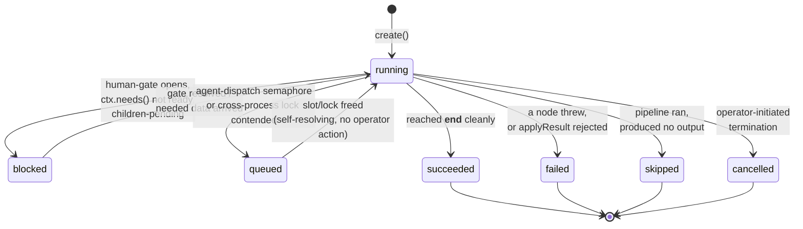

# manifold

**LangGraph-style pipeline runtime for openclaw.**

Manifold is a pipeline engine that runs as its own process (`manifold serve`:
HTTP API, executor, dashboard, plus an MCP server for tools); the openclaw
adapter (`plugins/openclaw/manifold`) starts it, supervises it, and bridges
agent turns back into the gateway. A `Pipeline` is `{ nodes, edges, state }`
loaded from a JS module; a `Flow` is one persistent run of a pipeline. The
executor walks nodes by id, applies their `stateUpdate`, picks the next id from
`edges[currentId](state)`, persists every revision to sqlite, and exits the
loop on a terminal or blocked status.

- **Pipelines as code** — nodes, edges and a static state shape in one JS module; the loader validates it and the watcher hot-reloads it.
- **Four node kinds** — `code`, `agent`, `subflow` (fan out into one real child flow per item), and `human-gate` / `gate` for operator decisions.
- **Durable runs** — every revision lands in `runtime.sqlite`; blocked flows resume with their state intact.
- **Operator surfaces** — a read-only dashboard, gate forms, and a failures inbox with per-pipeline recovery actions.
- **Cascade retry** — a flow-level `kind: "cascade"` turns node failure into an edge decision instead of a dead end.

This README is the orientation; the reference material lives under
[`docs/`](#documentation) and is written for engineers and agents working in
this repo or building pipelines against it. Source lives at
`igorjpimenta/manifold`.

## Install

Requires OpenClaw ≥ 2026.5.6. Install or update a release:

    openclaw plugins install npm:@igorjpimenta/manifold-openclaw@<version> --force --accept-capabilities

The tag is the install contract — versioning, tagging and the dashboard build
step are in [Releases](docs/releases.md).

## Quick start

1. Create `~/.openclaw/workspace/.pipelines/<id>/index.js` default-exporting
   `{ id, goal, state, nodes, edges }` — full schema and a copy-me skeleton in
   [Pipelines](docs/pipelines.md).
2. No restart needed: `pipelines-watcher.js` reloads on change. Verify with
   `openclaw manifold list` or `GET /api/pipelines/<id>`.
3. Run it:

       openclaw manifold start <id> --args '{"someInput":"x"}'

4. Watch it: `openclaw manifold runs`, `openclaw manifold status <flowId>`,
   or the dashboard at `http://127.0.0.1:44300`
   ([Dashboard](docs/dashboard.md)).

## How it fits together

- The **engine** is one process (`manifold serve`): it hosts the HTTP API, the executor loop, the dashboard, and an MCP server for tools.
- The **loader** (`loader.js`) discovers and validates pipeline modules under `pipelinesDir`.
- The **executor** (`executor.js`) drives the node loop, dispatches each node kind, and persists through the **state store** (`state-store.js`, one `runtime.sqlite`).
- The **dashboard** (`dashboard/server.js`, `dashboard/src/`) serves the read-only UI and the single actuation endpoint (gate approve).
- The **openclaw adapter** (`plugins/openclaw/manifold`) starts and supervises the engine, bridges agent turns back into the gateway, and stamps identity.

    pipeline module ──▶ loader ──▶ executor ──▶ runtime.sqlite
                                                  ▲
    openclaw agent ── MCP tools (start/status) ───┤
    operator ──────── dashboard / CLI ────────────┘

## Identity

Every dispatch is keyed on three dimensions, and only one is ambient: the
**harness** (`MANIFOLD_HARNESS` env for stdio, `X-Manifold-Harness` header for
HTTP), plus the **agent** and **session** of the turn. An agent node may pin
its own session; otherwise the harness adapter mints one — a dispatch that ends
with neither fails loudly, and nothing defaults. Manifold never calls out: no
push targets, no wake callbacks, no receiver sessions. Full contract, session
conventions and pipeline-directory resolution:
[plugins/README.md](plugins/README.md).

## Lifecycle

A flow is created `running` at `__start__`. The executor drives it until a
gate or a missing dependency blocks it, an operator cancels it, or it reaches a
terminal status:

Status semantics, the state keys the executor writes, and session-key rules:
[Lifecycle](docs/lifecycle.md).

## Documentation

| Goal | Start here |
| --- | --- |
| Author a pipeline: schema, cascade, recovery actions, mistakes, conventions | [Pipelines](docs/pipelines.md) |
| Node kinds, subflow fan-out, gate/discuss/needs authoring, groups | [Nodes](docs/nodes.md) |
| Run lifetime, status transitions, state conventions, session keys | [Lifecycle](docs/lifecycle.md) |
| Dashboard API and pipeline-declared views | [Dashboard](docs/dashboard.md) |
| CLI, agent tools, recovery recipes, troubleshooting, quirks | [Operations](docs/operations.md) |
| Config keys and defaults | [Configuration](docs/configuration.md) |
| Public API, code map, migrations, sqlite shape | [Internals](docs/internals.md) |
| Publish a release | [Releases](docs/releases.md) |

## CLI

All commands run as `openclaw manifold …`; implementation: `cli.js`.

| command | what it does |
| --- | --- |
| `list` | list discovered pipelines |
| `runs` | list flow runs |
| `start <pipelineId> [--args <json>] [--detach]` | start a flow |
| `status <flowId>` | status, currentStep, waitJson |
| `respond <flowId> <text>` | answer a needs-info wait |
| `approve <flowId> <itemId> <decision>` | resolve a gate (`approve` / `reject` / `edit --text …`) |
| `retry <flowId>` | retry a flow |
| `pause <flowId>` / `resume <flowId>` / `paused` | pause controls |
| `dashboard` | start/open the dashboard |
| `node-health status [pipelineId] [--all]` | circuit-breaker health |
| `node-health reset <pipelineId> <nodeId>` | unblock an unhealthy agent node |

The agent-facing surface is one tool (`manifold_start`) plus MCP transport —
see [Operations → Tool surface](docs/operations.md#tool-surface-agent-facing).

## Development

    npm install
    npm test

Development clone: `~/.dev/job/igorpimenta/manifold`. Story worktrees are
created at `<clone>/.doppler/.worktrees/<story>`, and each story ships as its
own PR (base `feat/plugin`).

## License

UNLICENSED. Releases publish to npmjs (`@igorjpimenta/manifold` and
`@igorjpimenta/manifold-openclaw`) at the tagged version via trusted
publishing; the git tag remains the release record
([Releases](docs/releases.md)).
