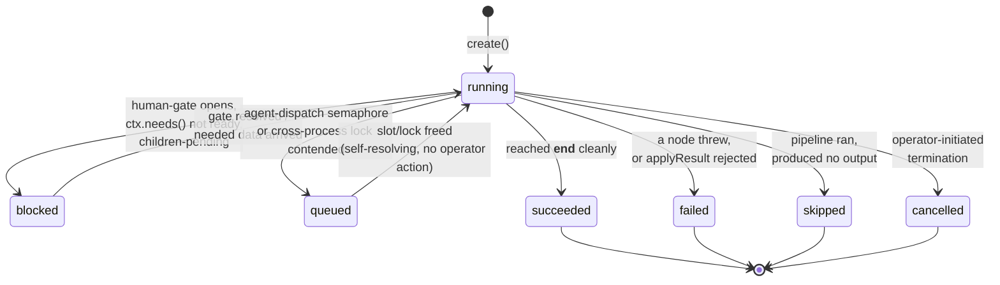

# manifold

**LangGraph-style pipeline runtime.**

Manifold is a pipeline engine that runs as its own process (`manifold serve`:
HTTP API, executor, dashboard, plus an MCP server for tools). Harness adapters
attach to it — the shipped adapter (`plugins/openclaw/manifold`, published as
`@igorjpimenta/manifold-openclaw`) starts and supervises the engine and
bridges agent turns into it. A `Pipeline` is `{ nodes, edges, state }` loaded
from a JS module; a `Flow` is one persistent run of a pipeline. The executor
walks nodes by id, applies their `stateUpdate`, picks the next id from
`edges[currentId](state)`, persists every revision to sqlite, and exits the
loop on a terminal or blocked status.

- **Pipelines as code** — nodes, edges and a static state shape in one JS module; the loader validates it and the watcher hot-reloads it.
- **Four node kinds** — `code`, `agent`, `subflow` (fan out into one real child flow per item), and `human-gate` / `gate` for operator decisions.
- **Durable runs** — every revision lands in `runtime.sqlite`; blocked flows resume with their state intact.
- **Operator surfaces** — a read-only dashboard, gate forms, and a failures inbox with per-pipeline recovery actions.
- **Cascade retry** — a flow-level `kind: "cascade"` turns node failure into an edge decision instead of a dead end.

This README is the orientation; the reference material lives under
[`docs/`](#documentation) and is written for engineers and agents working in
this repo or building pipelines against it. Source lives at
`igorjpimenta/manifold`.

## Install

Engine (standalone):

    npm install -g @igorjpimenta/manifold
    manifold serve

Harness adapter — OpenClaw (the shipped one; requires OpenClaw ≥ 2026.5.6):

    openclaw plugins install npm:@igorjpimenta/manifold-openclaw@<version> --force --accept-capabilities

The adapter spawns `manifold serve` for you and connects the host to its MCP
tools — see [the adapter README](plugins/openclaw/manifold/README.md).
Versioning, tagging and publishing: [Releases](docs/releases.md).

## Quick start

1. Create a pipeline module under the pipelines dir — by default
   `~/.manifold/pipelines/<id>/index.js` — default-exporting
   `{ id, goal, state, nodes, edges }` (full schema and a copy-me skeleton:
   [Pipelines](docs/pipelines.md)).
2. Start the engine (the loader/watcher picks the file up; edits hot-reload):

       MANIFOLD_BEARER=$(openssl rand -hex 32) manifold serve

3. Start a flow over the engine API (`127.0.0.1:44301`, bearer required):

       curl -X POST -H "Authorization: Bearer $MANIFOLD_BEARER" \
         -H 'Content-Type: application/json' \
         -d '{"pipelineId":"<id>","session":"<caller session>","agentId":"<caller agent>"}' \
         http://127.0.0.1:44301/manifold/start

4. Watch it: the dashboard at `http://127.0.0.1:44300`
   ([Dashboard](docs/dashboard.md)) or `GET /manifold/runs` on the API.
   Agents get the same operations as MCP tools (`manifold serve --mcp http`):
   `manifold_start`, `manifold_status`, `manifold_runs`, `manifold_approve`,
   `manifold_cancel`
   ([Operations](docs/operations.md#tool-surface-agent-facing)).

## How it fits together

- The **engine** is one process (`manifold serve`): HTTP API, executor loop, pipeline loader + watcher, flow revival, dashboard, MCP and WS servers.
- The **loader** (`loader.js`) discovers and validates pipeline modules under `pipelinesDir`.
- The **executor** (`executor.js`) drives the node loop, dispatches each node kind, and persists through the **state store** (`state-store.js`, one `runtime.sqlite`).
- The **dashboard** (`dashboard/server.js`, `dashboard/src/`) serves the read-only UI and the actuation endpoints (approve, cancel, rerun, pause, resume).
- The **harness adapter** (`plugins/openclaw/manifold`) spawns and supervises `manifold serve`, bridges agent turns into the engine, and stamps identity. Other harnesses attach the same way — the engine never calls out.

    pipeline module ──▶ loader ──▶ executor ──▶ runtime.sqlite
                                                  ▲
    harness agent ── MCP tools ───────────────────┤
    operator ──────── dashboard / API ────────────┘

## Identity

Every dispatch is keyed on three dimensions, and only one is ambient: the
**harness** (`MANIFOLD_HARNESS` env for stdio, `X-Manifold-Harness` header for
HTTP), plus the **agent** and **session** of the turn. An agent node may pin
its own session; otherwise the harness adapter mints one — a dispatch that ends
with neither fails loudly, and nothing defaults. Manifold never calls out: no
push targets, no wake callbacks, no receiver sessions. Full contract, session
conventions and pipeline-directory resolution:
[plugins/README.md](plugins/README.md).

## Lifecycle

A flow is created `running` at `__start__`. The executor drives it until a
gate or a missing dependency blocks it, an operator cancels it, or it reaches a
terminal status:

Status semantics, the state keys the executor writes, and session-key rules:
[Lifecycle](docs/lifecycle.md).

## Documentation

| Goal | Start here |
| --- | --- |
| Author a pipeline: schema, cascade, recovery actions, mistakes, conventions | [Pipelines](docs/pipelines.md) |
| Node kinds, subflow fan-out, gate/discuss/needs authoring, groups | [Nodes](docs/nodes.md) |
| Run lifetime, status transitions, state conventions, session keys | [Lifecycle](docs/lifecycle.md) |
| Dashboard API and pipeline-declared views | [Dashboard](docs/dashboard.md) |
| Engine CLI, MCP tools, HTTP recipes, troubleshooting, quirks | [Operations](docs/operations.md) |
| Engine env and adapter config keys | [Configuration](docs/configuration.md) |
| Public API, code map, migrations, sqlite shape | [Internals](docs/internals.md) |
| Publish a release | [Releases](docs/releases.md) |

## CLI

The engine binary serves; it has no run-manipulation subcommands:

| command | what it does |
| --- | --- |
| `manifold serve` | boot the full app — API (44301), executor, loader/watcher, revival, dashboard (44300) |
| `manifold serve --mcp stdio` | pipeline tools over MCP stdio (harness declared via `MANIFOLD_HARNESS`) |
| `manifold serve --mcp http [--port N] [--host H]` | the same tools over Streamable HTTP (`MANIFOLD_BEARER` + `X-Manifold-Harness`) |
| `manifold serve --ws [--port N] [--host H]` | push event stream (default 44303) |

Flow operations — start, cancel, gates, retry, rerun — are HTTP routes on the
engine API and MCP tools: [Operations](docs/operations.md).

## Development

    npm install
    npm test

## License

[MIT](LICENSE). Releases publish to npmjs (`@igorjpimenta/manifold` and
`@igorjpimenta/manifold-openclaw`) at the tagged version via trusted
publishing; the git tag remains the release record
([Releases](docs/releases.md)).
