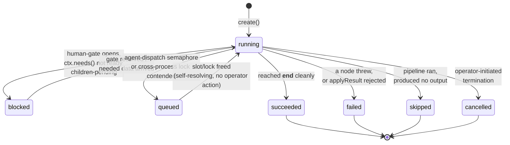

# Lifecycle

How a flow moves from creation to a terminal status, what the executor persists, and how sessions are keyed.

## Run lifetime


A flow is created `running` at `__start__` (`store.create`). The executor
loop repeatedly resolves `edges[lastStep](state)` to the next node id,
dispatches it per its `kind` (`code` runs `node.run`; `agent` builds a
prompt and dispatches an agent turn; `subflow` fans `.selector(state)` out
into real child `flow_runs`, one per item, and blocks until every sibling
is terminal; `human-gate` builds `waitJson` and blocks), and persists the
outcome — a `stateUpdate` advances and loops again, a thrown error or
`_error` sentinel fails/blocks the flow, `__end__` runs `runAudit` and
writes the terminal status (`succeeded`/`failed`/`skipped`). Blocked flows
resume through the dashboard or `POST /manifold/gate/resolve`; any
non-terminal flow can be cancelled (`POST /manifold/cancel`, MCP
`manifold_cancel`, or the dashboard).


## Status transitions

Real status values only — verified directly against `state/run-store.js`'s
own literal `status:` writes, not assumed from method names (`setWaiting`
the method actually writes status `blocked`; there is no `waiting` status
at all, despite the method's own name):



| Status        | What it means                                                                                    |
| ------------- | ------------------------------------------------------------------------------------------------ |
| `running`     | Executor loop is (or should be) driving this flow.                                               |
| `blocked`     | `waitJson` is set; an operator/external actor must clear it (human-gate, `ctx.needs()` not-ready, children-pending). Executor exited the loop. |
| `queued`      | Waiting on an *internal* resource that frees itself (agent-dispatch semaphore, cross-process lock) — distinct from `blocked` specifically so consumers can tell "needs a human" from "will resolve on its own" without inspecting `wait_json.kind`. |
| `succeeded`   | Reached `__end__` cleanly. Terminal.                                                             |
| `failed`      | A node threw, or an applyResult rejected. Terminal. Also where a bare `ctx.blocked()` call ends up today — see [Nodes → Code-node `ctx` argument](nodes.md#code-node-ctx-argument). |
| `skipped`     | Pipeline ran but produced no output (nothing to score, all filtered, cap reached). Terminal.     |
| `cancelled`   | Operator-initiated termination via `POST /manifold/cancel`, MCP `manifold_cancel`, or the dashboard.   |


## State conventions

Keys the executor writes; the dashboard reads:

| Key             | Type                                       | Purpose                                                                          |
| --------------- | ------------------------------------------ | -------------------------------------------------------------------------------- |
| `runId`         | string (UUID)                              | Assigned at `start`. Stable across restarts.                                     |
| `pipelineId`    | string                                     | The pipeline that owns this flow.                                                |
| `startedAt`     | number (ms epoch)                          | Set at `start`.                                                                  |
| `endedAt`       | number (ms epoch)                          | Set at terminal transition.                                                      |
| `args`          | object                                     | The JSON passed via `start --args '…'`. Merged into initial state, not mutable. |
| `_subflowGroups` | `{ [groupId]: { [subflowKey]: SubflowData } }`     | **Transient, never persisted.** Computed fresh each step by `assembleState()` — dual-mode: real `flow_runs` children for any subflow node, `flow_branches` fallback for flows that have no `flow_runs` children. Pipeline code reads `state._subflowGroups?.GROUP?.[key]?.data?.<subNodeId>`. See `SubflowData` in `dashboard/src/api/types.ts`. |

The dashboard derives the path-trail from `GET
/manifold/runs/:flowId/tree` (`flow_node_invocations`/`flow_node_executions`),
one row per invocation rather than one entry per dispatch — a retried node
collapses to a single pill instead of showing consecutive duplicates. Also
worth knowing: `state_json` holds no key per
dispatched node at all — the table above is the complete list of what's
actually in it; a node's own output lives in
`flow_node_invocations.result_json`, reconstructed on read by
`assembleState()`, never in the raw column.

Errors are NOT a state field — pipeline code never writes them directly.
Every node failure (top-level or inside a `subflow`) is recorded to
`flow_node_executions` (via `nodeExecutionsStore.write(..., error)`) and
served normalized as `errorEntries: [{ nodeId, subflowKey, message, at, executionId, invocationId }]` —
a top-level field sibling to `stateJson` on `GET /manifold/runs/:flowId`
and on each row of `GET /manifold/runs/:flowId/subflows`, not something
nested inside `stateJson`. Dashboard and companion clients render from `errorEntries`, not
from any `state.errors` key.

User-defined keys: anything else. Don't shadow the names above.


## Session keys (agent nodes dispatched by manifold)

Manifold does not mint session ids: the harness owns the format. An
agent node may pin its own; otherwise the harness adapter mints one for the
dispatch, so pipelines carry no harness key syntax.

```
node.session                               // pinned, passed through verbatim
node.sessionBuilder(state, flowId)         // pinned, derived by the node
sessions.newNodeSessionId({agentId, flowId, nodeId})   // harness adapter
```

Resolution order is node-declared first, then the adapter's mint function.
`dispatchAgentEntry` refuses a dispatch that ends with neither — tool-handoff
and the lineage ledger both key off this value, so neither manifold nor a
default may invent one. `sessions` is the same harness-adapter object the
discuss routes get (`newDiscussSessionId`); `manifold serve` ships a
harness-neutral one, and each in-process adapter provides its own. A discuss
thread carries its own session id, locked on the first turn and re-used for
every later turn of that thread.

Transcript attribution comes from the session ledger, never from the key's
shape.

A session is one conversation the harness owns; manifold addresses it by
id and never opens its files. Transcript content comes from the harness's
own surfaces (and, for discuss threads, from the messages manifold
persisted itself).
